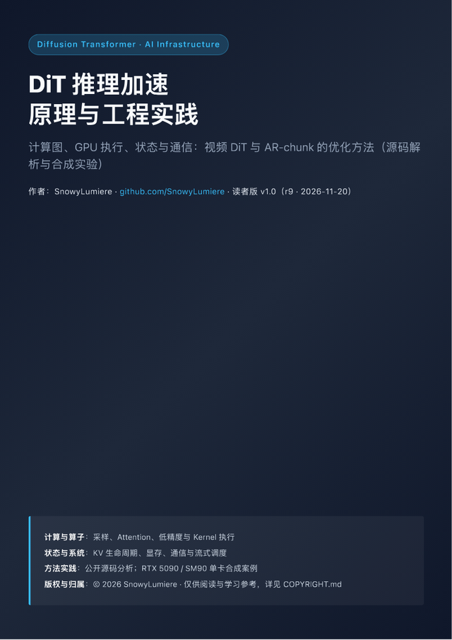
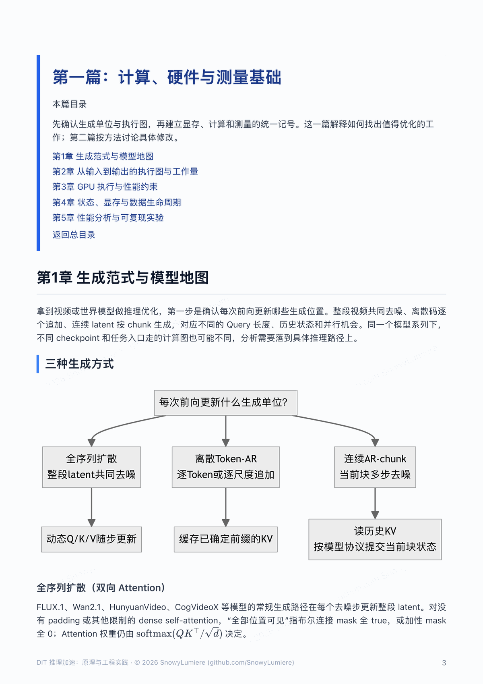
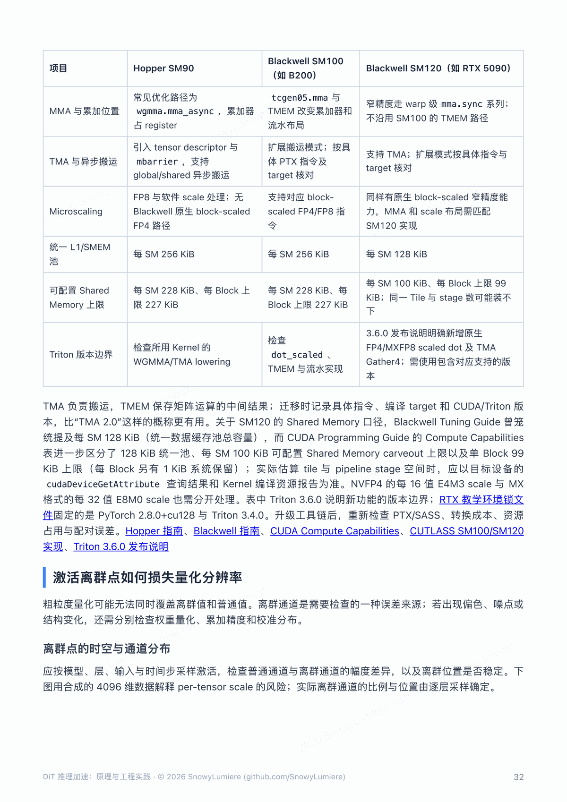
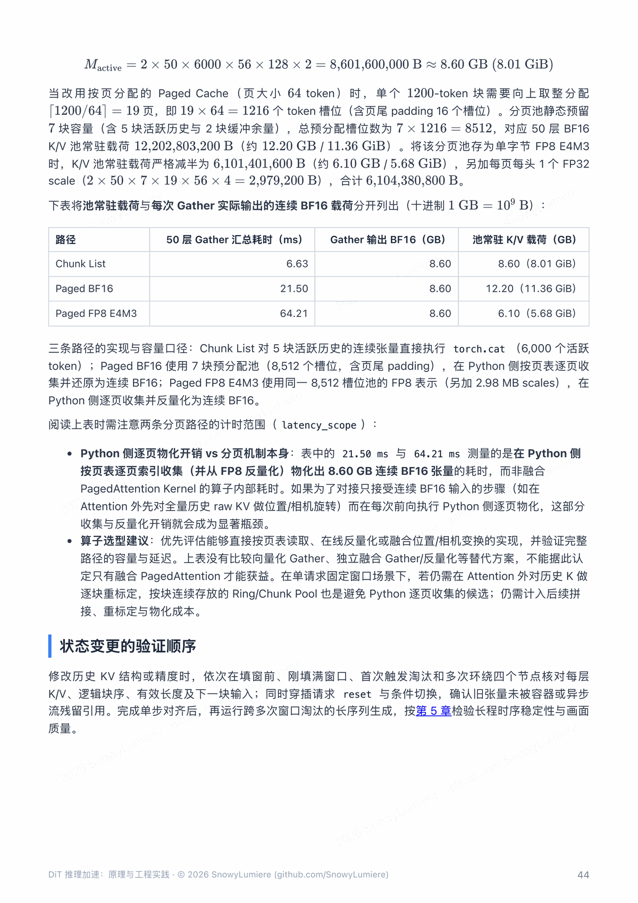
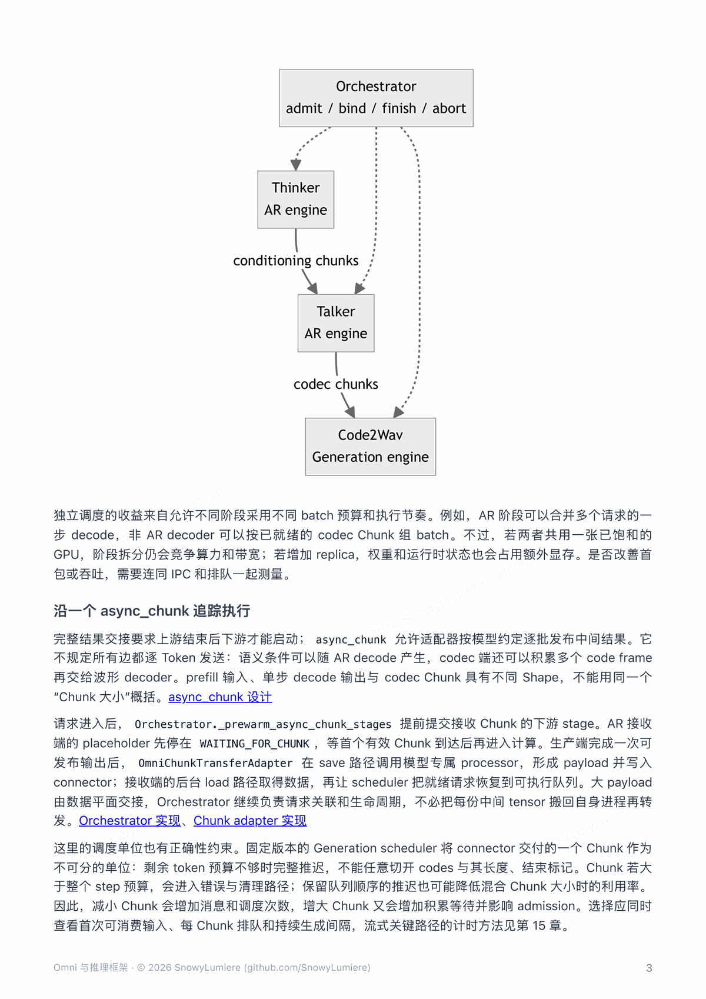

# DiT 推理加速：原理与工程实践

> 视频扩散模型（Wan2.2）与连续 AR-chunk 模型（SolarWM / Self Forcing）的 63 页开源工程读本 + 7 页 vLLM-Omni / SGLang-Omni 源码拆解。  
> <sub>English: Free 63-page Video DiT & AR-chunk inference handbook (zh prose; universal CUDA/Python code & SM90 / RTX 5090 receipts) + 7-page Omni serving companion.</sub>

[](https://github.com/snowyLumiere/DiT-Inference-Acceleration/releases/tag/v1.0-r9)
[](DiT_Inference_Acceleration_Whitepaper_v1.0.pdf)
[](Omni_Inference_Frameworks.pdf)
[](https://github.com/snowyLumiere/DiT-Inference-Acceleration/discussions)

<table>
  <tr>
    <td width="220" valign="top" align="center">
      <a href="DiT_Inference_Acceleration_Whitepaper_v1.0.pdf">
        
      </a>
    </td>
    <td valign="top">
      <p><strong>获取方式</strong></p>
      <ul>
        <li>📦 <strong><a href="https://github.com/snowyLumiere/DiT-Inference-Acceleration/releases/tag/v1.0-r9">下载完整离线包（v1.0-r9 ZIP + SHA256）</a></strong>（推荐：含双 PDF + 离线 HTML + 代码数据）</li>
        <li>📘 <a href="DiT_Inference_Acceleration_Whitepaper_v1.0.pdf">主册 PDF（63 页）</a> · <a href="build_whitepaper.html">离线 HTML</a> · <a href="READ_FIRST.md">阅读指南</a></li>
        <li>📗 <a href="Omni_Inference_Frameworks.pdf">Omni 配套 PDF（7 页）</a> · <a href="Omni_Inference_Frameworks.html">离线 HTML</a> · <a href="examples/README.md">实验代码</a></li>
      </ul>
      <p><strong>核心看点</strong></p>
      <ul>
        <li><strong>源码主线</strong>：沿固定 commit 拆解双向（Wan2.2）与连续 AR-chunk（SolarWM / Self Forcing）接入点。</li>
        <li><strong>硬件边界</strong>：对比 Hopper SM90、B200 (SM100) 与 RTX 5090 (SM120) 的 SMEM / MMA / P2P 实操差异。</li>
        <li><strong>真实负结果</strong>：保留热路径现 pin 带宽腰斩（55 → 28 GB/s）、Python 侧分页 FP8 Gather 慢近 10 倍（6.63 → 64.21 ms）等踩坑实测。</li>
        <li><strong>多阶段框架</strong>：配套拆解 vLLM-Omni 与 SGLang-Omni 的 <code>async_chunk</code>、NIXL / CUDA IPC 与背压。</li>
      </ul>
      <p><sub>边界说明：v1.0 定位为源码解析与单卡合成实验（SM90 / RTX 5090），不含整模端到端测速；作者 <a href="https://github.com/snowyLumiere">SnowyLumiere</a>。</sub></p>
    </td>
  </tr>
</table>

## 内页预览

<table>
  <tr>
    <td width="50%" valign="top" align="center">
      <a href=".github/assets/preview-paradigms.png"></a>
      <br /><sub><b>主册 P3</b> · 双向扩散 vs 连续 AR-chunk（<a href="docs/manuscript/01-paradigms.md">第 1 章</a>）</sub>
    </td>
    <td width="50%" valign="top" align="center">
      <a href=".github/assets/preview-sm120-checklist.png"></a>
      <br /><sub><b>主册 P32</b> · SM90 / B200 / RTX 5090 核对表（<a href="docs/manuscript/10-gemm-and-quantization.md">第 10 章</a>）</sub>
    </td>
  </tr>
  <tr>
    <td width="50%" valign="top" align="center">
      <a href=".github/assets/preview-ar-kv-gather.png"></a>
      <br /><sub><b>主册 P44</b> · 50 层 AR KV Gather 负结果（<a href="docs/manuscript/12-ar-state.md">第 12 章</a>）</sub>
    </td>
    <td width="50%" valign="top" align="center">
      <a href=".github/assets/preview-omni-arch.png"></a>
      <br /><sub><b>Omni P3</b> · 多阶段调度与 <code>async_chunk</code>（<a href="docs/omni/inference-frameworks.md">配套正文</a>）</sub>
    </td>
  </tr>
</table>

## 目录

**第一篇：基础与测量**（[篇内目录](docs/manuscript/part-1.md)）
- [01 生成范式与模型地图](docs/manuscript/01-paradigms.md) · [02 执行图与工作量](docs/manuscript/02-execution-graph.md) · [03 GPU 执行与约束](docs/manuscript/03-gpu-execution.md) · [04 状态与显存生命周期](docs/manuscript/04-memory-and-state.md) · [05 性能分析与复现](docs/manuscript/05-measurement.md)

**第二篇：加速方法与实践**（[篇内目录](docs/manuscript/part-2.md)）
- [06 求解器、CFG 与蒸馏](docs/manuscript/06-evaluations-and-distillation.md) · [07 特征缓存与 TeaCache](docs/manuscript/07-feature-cache.md) · [08 Dense & 低精度 Attention](docs/manuscript/08-attention-kernels.md)
- [09 稀疏与 Token 压缩](docs/manuscript/09-sparsity-and-tokens.md) · [10 GEMM、量化与 SM120](docs/manuscript/10-gemm-and-quantization.md) · [11 融合、编译与 CUDA Graph](docs/manuscript/11-fusion-and-graphs.md)
- [12 AR 历史 KV 与状态](docs/manuscript/12-ar-state.md) · [13 驻留、Offload 与 H2D](docs/manuscript/13-residency-and-transfer.md) · [14 多 GPU 并行与通信](docs/manuscript/14-parallelism.md)
- [15 3D-VAE 与流式交付](docs/manuscript/15-decoding-and-streaming.md) · [16 组合优化与回归验收](docs/manuscript/16-composition-and-validation.md)

**配套与附录**
- [Omni 推理框架（vLLM-Omni / SGLang-Omni）](docs/omni/inference-frameworks.md) · [延伸阅读](docs/manuscript/extension-omni.md) · [附录 A 配置](docs/manuscript/appendix-a-model-contracts.md) · [附录 B 复现](docs/manuscript/appendix-b-reproduction.md) · [附录 C 数据索引](docs/manuscript/appendix-c-evidence.md)

## 离线核验（无需 GPU）

仅用 Python 标准库即可重算书内全部 SM90 / RTX 5090 实验统计与单测（详见 [examples/README.md](examples/README.md)）：

```bash
python3 -B examples/review_public_evidence.py
python3 -B examples/review_public_evidence.py --input docs/manuscript/evidence/measurements_sm90.json
python3 -B examples/review_public_evidence.py --input docs/manuscript/evidence/ar_microbench_sm90.json
python3 -B -m unittest discover -s examples -p 'test_*.py' -v
```

## 相关开源项目

- **[driftguard-dit](https://github.com/snowyLumiere/driftguard-dit)**：自回归流式 DiT / 世界模型的零训练 latent 漂移监测与早停校准（对应第 5、6、12 章）。
- **[MaskBench-Viz](https://github.com/snowyLumiere/MaskBench-Viz)**：多模态注意力掩码 → 物理计算 Tile 交互式可视化工具（对应第 2、8、9 章）。

## 说明与反馈

- **版本与校验**：`v1.0 (r9 · 2026-11-20)`；PDF 已实测兼容 Zotero 10 与 macOS/iOS；解压 [Release 压缩包](https://github.com/snowyLumiere/DiT-Inference-Acceleration/releases/tag/v1.0-r9) 后可运行 `python3 -B scripts/verify_reader_package.py` 校验 243 个发行文件（[发布说明](RELEASE_NOTES_R9.md) · [配套说明](RELEASE_DIT_INFRA.md)）。
- **版权与引用**：详见 [COPYRIGHT](COPYRIGHT.md) 与 [THIRD_PARTY_NOTICES](THIRD_PARTY_NOTICES.md)；引用格式：`SnowyLumiere. 《DiT 推理加速：原理与工程实践》, v1.0 (r9), 2026.`
- **勘误与 v1.1 投票**：欢迎前往 [Discussions](https://github.com/snowyLumiere/DiT-Inference-Acceleration/discussions) 反馈勘误或投票决定 `v1.1` 首个端到端实测案例。如果对你有帮助，欢迎点一颗 **Star**。
