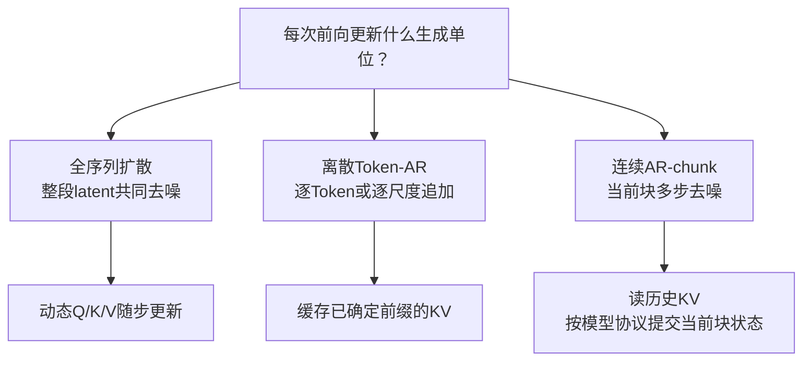

# 第1章 生成范式与模型地图

拿到视频或世界模型做推理优化，第一步是确认每次前向更新哪些生成位置。整段视频共同去噪、离散码逐个追加、连续 latent 按 chunk 生成，对应不同的 Query 长度、历史状态和并行机会。同一个模型系列下，不同 checkpoint 和任务入口走的计算图也可能不同，分析需要落到具体推理路径上。

## 三种生成方式

### 全序列扩散（双向 Attention）

FLUX.1、Wan2.1、HunyuanVideo、CogVideoX 等模型的常规生成路径在每个去噪步更新整段 latent。对没有 padding 或其他限制的 dense self-attention，“全部位置可见”指布尔连接 mask 全 true，或加性 mask 全 0；Attention 权重仍由 $\operatorname{softmax}(QK^\top/\sqrt d)$ 决定。

常规实现会随当前 latent 重新计算其 KV，不直接复用上一去噪步的动态 KV；条件编码、scheduler 的多步历史和特征缓存各自独立维护。只有当各步的张量形状、分支和执行路径都一致时，总工作量才可近似为调用次数乘以单次 FLOPs。长序列能提供充足的并行工作，但是否跑满 Tensor Core 还取决于矩阵几何、内存布局和所选 Kernel。

### 离散 Token 自回归（Discrete Token-AR）

LlamaGen 按 token 顺序生成离散码；VAR 则按尺度生成网格，尺度之间因果、同尺度内并行。Mask 与单次 query 长度随生成单位而变化。[VAR 原生实现](https://github.com/FoundationVision/VAR/blob/a5cf0a16624d27b4c687b08f2a0ab006438452cc/models/var.py)按 scale ID 构造训练 mask，并在推理时逐尺度更新 KV。TiTok 是一种 tokenizer，其[原始工作](https://arxiv.org/abs/2406.07550v1)搭配 MaskGIT 式生成，不归入普通因果 AR。

Prefill 并行处理给定前缀，前缀长度由输入决定。采用 KV cache 时，Decode 只计算当前生成单位：batch 很小、每次 query 为 1 时，线性投影退化为 GEMV 形状，attention 也容易受限于 KV 读取带宽与并行度不足；VAR 的 query 数随尺度增长，后期大尺度网格更接近矩阵乘几何。离散码预测通常输出 logits 并采样，不在每个 token 上执行迭代去噪。

### 连续因果分块扩散（Continuous Causal Chunk Diffusion）

SolarWM-H3、CausVid 和 Self Forcing 等路线按时间块生成连续 latent，当前块内部仍执行多步去噪求解。块内可采用双向 attention，跨块依赖已经生成的历史；块大小、历史噪声水平、可见窗口与 KV 保存位置由各自训练和实现规定。

在“先去噪、再提交 clean 上下文”的实现中，两类前向承担不同职责：最后一次去噪使用的是更新前的带噪 latent，提交历史则使用最终预测的 clean latent。[Self Forcing 官方推理](https://github.com/guandeh17/Self-Forcing/blob/7b27679bb0a30603a9a6520030474b6ef62d86dd/pipeline/causal_inference.py)同样包含去噪后的 context 更新。两类调用的计数与成本拆解见[第6章](06-evaluations-and-distillation.md)。

## 模型地图需要多个分类轴

| 分类轴 | 需要记录的内容 | 对推理分析的影响 |
|---|---|---|
| 生成单位 | 全序列、chunk、token 或 scale | 决定当前 Q 长度、并行度与状态提交频率 |
| 条件入口 | cross-attention、joint attention、modulation、位置或相机变换 | 决定哪些计算随 latent 变化，哪些只依赖条件 |
| 主干组织 | Dense、按噪声阶段选 expert、按 token 路由的 MoE | 激活参数、常驻权重与通信开销各不相同 |
| 预测与训练 | epsilon/v/data 预测、Flow Matching、少步或 CFG 蒸馏 | scheduler、时间坐标和可用步数受配套协议约束 |
| 交付方式 | 离线视频、逐块流式、联合音视频 | 总延迟、首包与持续播放对应不同的验收指标 |

[Wan2.2 T2V 入口](https://github.com/Wan-Video/Wan2.2/blob/1ea34ff48f87168174e12956e200b1d908b1c5ff/wan/text2video.py)加载 high-noise 和 low-noise 两份主干，按时间步与 boundary 切换当前模型。这里的 expert 选择发生在噪声阶段，单次前向只激活其中一份网络；但两份权重是否同时常驻显存，决定了设备的静态容量基线。

[公开 H3 说明](https://github.com/MiniMax-AI/MiniMax-H3/blob/d21241f0a4b3acbb34c97dae47fa417b7065e438/README.md)与 SolarWM 的 H3 派生路径在历史读写、窗口和位置接口上各有约定。[ABot-World 论文](https://arxiv.org/abs/2607.19191v1)则提供了双向 teacher 与因果 student 训练流程的对照。

## 两条实践主线及阅读方式

第二篇以 Wan2.2 的公开入口说明双向模型的计算路径，以 SolarWM、CausVid 和 Self Forcing 说明连续 AR 的状态与训练差异。源码分析用于定位修改位置，合成实验用于隔离验证算子与数据搬运机制；H3 与 ABot-World 在架构或训练差异影响优化策略时展开。

这些公开论文与仓库按生成范式、源码可读性和状态协议选取，用来把不同优化接入点串成完整脉络。离散 Token-AR 用于对照 KV 状态与投机接受机制；Omni 多阶段服务调度单独放入[配套文档](../omni/inference-frameworks.md)。
