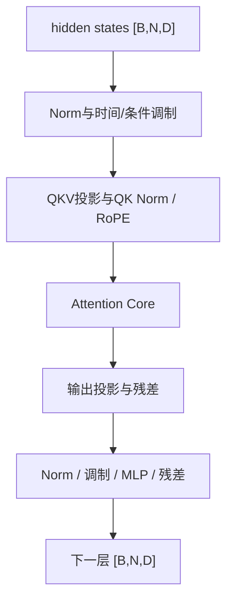

# 第2章 从输入到输出的执行图与工作量

一次请求不仅是若干次 Attention。条件编码、patch 投影、每层 QKV/MLP、归一化、采样更新、状态刷新和解码构成完整执行图。本章先把几何和工作量列清，后续各章再决定改变哪一项。

## 从 latent 到时空 Token

### Patchify 后有多少 Token
视频生成模型通常在 3D-VAE 的低维潜空间（Latent Space）中进行特征变换。
设潜空间输入张量为 $Z \in \mathbb{R}^{B \times C \times T \times H \times W}$，其中：
* $B$ 为 Batch Size；
* $C$ 为潜变量通道数，由具体 codec 定义；
* $T$ 为经 VAE 时间压缩后的时序长度；
* $H, W$ 为经 VAE 空间压缩后的高度和宽度。

采用无重叠的切块尺寸 $(p_t,p_h,p_w)$，且三个维度均可整除时：
$$N_{\text{video}} = \frac{T}{p_t} \times \frac{H}{p_h} \times \frac{W}{p_w}$$
尺寸无法整除时，查看实现采用 padding、裁剪还是拒绝输入。无 padding、stride 等于 kernel 的卷积会向下取整，边缘覆盖范围也随之变化。像素帧数到 latent 帧数也要查 codec，因果 codec 可能有首帧偏置。
映射后的张量形状为 $X_{\text{video}} \in \mathbb{R}^{B \times N_{\text{video}} \times D}$，其中 $D$ 为 Transformer 隐藏层维度（Hidden Dimension）。

### 条件接入方式与 Packed 布局

“模型同时接收文本与视频”不表示它们共享同一个 self-attention 序列。joint attention 会拼接参与交互的 token；cross-attention 则以视频为 query、文本等条件为 KV。例如[Wan2.1 的 `WanT2VCrossAttention`](https://github.com/Wan-Video/Wan2.1/blob/76e9427657c74f7d063f6c50fce9529900c59e28/wan/modules/model.py)分别投影 `x` 与 `context`。时间、类别或相机条件还可能通过 modulation 或位置变换接入，不一定占用额外 token。

对于确实使用 joint attention 的实现，一个样本的逻辑序列可以写为：
$$X_{\text{total}} = [X_{\text{text}} \,\|\, X_{\text{ref}} \,\|\, X_{\text{video}} \,\|\, X_{\text{audio}}] \in \mathbb{R}^{1 \times N_{\text{total}} \times D}$$
其中 $N_{\text{total}}=\sum_m N_m$。这里仅示意逻辑布局，具体模态顺序由模型定义。逻辑拼接与跨样本 packing 也要分开：后者才是在支持变长的 kernel 中省去样本间 padding 的一种方式。

变长 Attention（varlen）接口中的 `cu_seqlens` 标记独立样本的序列边界。同一样本内需要相互注意的模态应放在同一序列中，模态边界另行记录，允许的交互关系由 Attention Mask 指定：
```text
单个多模态样本: cu_seqlens = [0, N_total]
两个独立样本:   cu_seqlens = [0, N_sample0, N_sample0 + N_sample1]
```
若将 text/ref/video 各段作为 `cu_seqlens` 中的独立序列，这些段之间就不再计算 Attention。跨样本 packing 可以减少 padding 开销，仍需核验所选 Kernel 对数据布局和 Mask 的支持。

### 序列长度对注意力的影响
考虑一个几何算例，假设输入 1920×1080、120 帧，codec 恰按时间 4 倍、空间 8 倍缩小，得到 $30\times135\times240$ latent。若 patch 为 $1\times2\times2$，高度 135 不能整除 2。假设实现允许将 latent 高度补到 136，则：
$$N_{\text{video}}=30\times68\times120=244,800$$
在 batch 为 1、32 个 head、每元素 2 bytes 时，仅一份完整 score 矩阵就需要：
$$B H_{\text{heads}}N^2b=1\times32\times244,800^2\times2\approx3.84\text{ TB}$$
其中 $1\text{ TB}=10^{12}\text{ bytes}$（全文约定十进制单位 MB、GB、TB 分别表示 $10^6,10^9,10^{12}\text{ bytes}$，二进制单位 KiB、MiB、GiB 分别表示 $2^{10},2^{20},2^{30}\text{ bytes}$），容量未计其他张量。这个几何算例不对应某个模型的原生输入配置，但足以说明保存完整注意力分数矩阵的显存成本。采用分块 Attention 可以避免这份完整中间矩阵，无须为此强制引入多卡序列切分；Dense Attention 的二次方计算量仍然存在。

## DiT Block 中的主要路径



这是常见路径示意，具体模型可增加 cross-attention 或多模态分支。实际 Kernel Launch 数要沿 trace 统计：view 可能只改元数据，一次库调用也可能发射多个 Kernel。残差、Norm 与位置变换的 FLOPs 较少，但中间张量和 launch 仍可能进入关键路径。

## 单层工作量与显存流量

### 投影、Attention 与 MLP 的工作量

以一个标准 DiT Block 为例，设定隐藏层维度为 $D$、序列长度为 $N$、注意力头数为 $H$、每个 Head 维度为 $d = D/H$：

#### 浮点运算量（FLOPs，按单 Batch 计）
* **QKV 投影**：$W_{qkv} \in \mathbb{R}^{D \times 3D}$，计算量为 $2 \times N \times D \times 3D = 6 N D^2$；
* **Attention Core**：
  * $QK^T$ 矩阵乘：$2 \times N \times N \times D = 2 N^2 D$；
  * $\text{Softmax}(S) \cdot V$ 矩阵乘：$2 \times N \times N \times D = 2 N^2 D$；
  * Attention Core 合计：$4 N^2 D$；
* **输出投影 Out Linear**：$W_o \in \mathbb{R}^{D \times D}$，计算量为 $2 \times N \times D \times D = 2 N D^2$；
* **前馈网络（MLP）**：
  * **标准 GELU MLP**（2 层 Linear，隐层维度 $4D$）：
    $$\text{FLOPs}_{\text{GELU}} = 2 \times (2 \times N \times D \times 4D) = 16 N D^2$$
  * **SwiGLU MLP**（3 层 Linear，隐层维度通常取 $\frac{8}{3}D$）：
    $$\text{FLOPs}_{\text{SwiGLU}} = 3 \times \left(2 \times N \times D \times \frac{8}{3}D\right) = 16 N D^2$$
  * 若 SwiGLU 隐层维度按 $4D$ 配置，则计算量扩展为 $24 N D^2$。

单 Block 总运算量（以 $16ND^2$ MLP 计）：
$$\text{FLOPs}_{\text{block}} = 24 N D^2 + 4 N^2 D$$

AR-chunk 中应将 query 长度与 KV 长度分开。设当前块有 $M$ 个 query、可见 KV 共 $L_{\text{KV}}$ 个 token，在上述 MHA 宽度假设下，attention core 为 $4BM L_{\text{KV}}D$ FLOPs。当前块的 QKV 投影、输出投影与 MLP 约为 $24BM D^2$；已缓存的历史 KV 不重复投影，新增条件分支另算。连续 AR 的一个 chunk 通常包含千余至数千个 query；此时投影仍是矩阵乘，应代入实际 $M$，而不是按单 Token Decode 的 GEMV 估算。

#### 设备显存流量（Device-memory traffic）
显存流量取决于 Attention 的具体底层实现方式：

* **实现方式 A：显式保存注意力矩阵**。注意力分数（score）是 $QK^\top/\sqrt d$，概率矩阵（probability）是其逐行 softmax 的结果；每个 head 的两种矩阵形状均为 `[N,N]`。若将其中任一种完整写入显存，设 head 数为 $H$、每元素占 $b$ bytes，中间矩阵相关流量随 $HN^2b$ 增长；具体读写次数取决于 softmax 和算子融合方式。前述 MLP 假设下，投影与 MLP 共含 $12D^2$ 个权重元素；一次权重读取或一次注意力矩阵读写都不代表完整 Block 的实际流量。

* **实现方式 B：FlashAttention 分块计算**。分块与 online softmax 避免将完整的 $N\times N$ 分数或概率矩阵写入显存，辅助存储随序列长度线性增长，但 KV 可能被不同 query tile 重复读取。HBM 流量还要结合 tile 和 KV 重读次数分析。

在两级存储分析中，令 $d=D/H$ 为单 head 维度、$M$ 为可用快存容量（以元素计），单 head attention 的 IO 含 $Nd+N^2d^2/M$ 量级项；实际 L2 复用、tile 和 kernel 还会改变流量。见[FlashAttention 原论文](https://arxiv.org/abs/2205.14135)与[IO 复杂度分析](https://arxiv.org/abs/2402.07443)。算术强度需按实际流量计算，再用硬件计数器判断限制来自计算还是带宽。

## Wan2.2：沿原生入口核对一次请求

[固定源码](https://github.com/Wan-Video/Wan2.2/blob/1ea34ff48f87168174e12956e200b1d908b1c5ff/wan/text2video.py)依次编码正、负文本条件，准备噪声和 scheduler 时间表，选择当前噪声阶段的主干，再分别执行 conditional 与 unconditional 前向，组合预测后调用 scheduler 更新 latent。最后在输出 rank 执行 VAE decode。只改变 guidance 数值时，这两次主干调用仍会执行；省去分支需要修改路径或采用匹配的蒸馏模型。

设 scheduler 实际迭代 $S$ 次，且每次都走上述两次 model 调用，则源码路径的主干调用数为 $2S$。两份 expert 各承担多少次取决于时间表与 boundary；每步只执行被选中的一份 expert。这个源码计数用于明确工作量，实际延迟再测。改变 scheduler、分支合批或蒸馏入口后应重新计数。

## AR：每块去噪与状态提交分开

设一个 chunk 有 $C$ 个 latent 时间片，每片经 patchify 后有 $P$ 个视频 Token，则当前视频 query 长度为 $M=CP$。历史窗口如果保留 $K$ 个完整 chunk，视频历史长度为 $KCP$；reference、音频和其他条件是否进入同一 Attention 序列，需按模型分别计数。

每块执行 $S$ 次去噪、$R$ 次上下文更新时，主干调用数为 $S+R$。上下文更新还包含状态写入，成本未必与去噪相同。先在日志中区分 denoise 与 commit，再统计每层调用及其 Shape；[第12章](12-ar-state.md)沿状态生命周期解释为什么两者需要分开。
