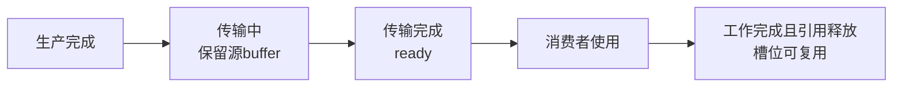

# 第4章 状态、显存与数据生命周期

显存溢出（OOM）往往发生在某个短暂的张量共存窗口。静态模型权重大小、单次前向结束后的 `allocated` 读数，或者各模块单独测得的峰值，都不能直接相加当作完整请求的显存需求。排查显存问题，需要建立一张覆盖张量身份、存活区间与设备放置的生命周期账本。

## 一个按生命周期组织的账本

| 对象 | 常见存活范围 | 优化时容易漏算什么 |
|---|---|---|
| 权重与 adapter | 模型加载到卸载 | 多 expert、低精度 scale、未量化层、合并临时副本 |
| activation 与 residual | 一层或一段前向 | 旧缓存和新计算结果同时存活、view 持有较大 storage |
| Kernel workspace | 调用或后端缓存范围 | autotune、算法选择、packing 及反量化缓冲 |
| AR 历史 KV | 多个 chunk | K/V 表示、有效长度、淘汰与当前 refresh 写入重叠 |
| Graph 私有池 | Graph 及相关 tensor 有效期间 | 多 Shape 捕获、输出仍被消费者持有 |
| 解码及交付缓冲 | decoder 上下文到消费完成 | overlap 帧、拼接结果、在途队列、慢 reader |

对设备 $d$，用 $L_d(t)$ 表示时刻 $t$ 仍存活并占用该设备底层存储（storage）的对象集合，则实时活跃字节数与请求峰值为：

$$\mathrm{live\_bytes}_d(t)=\sum_{x\in L_d(t)}\mathrm{storage\_bytes}(x),\qquad
\mathrm{peak\_live}_d=\max_t\,\mathrm{live\_bytes}_d(t)$$

共享同一底层 `storage` 的多个 `view` 只计一次。PyTorch 的 `allocated`、`reserved` 与驱动级显存统计的口径差异见[第5章](05-measurement.md)；缓存分配器与 CUDA Graph 私有池机制可参考[CUDA 内存管理说明](https://docs.pytorch.org/docs/2.8/notes/cuda.html#memory-management)。

## 四类缓存有不同的有效性条件

推理系统里常见的四类缓存具有截然不同的失效边界：跨步特征缓存复用近似的网络输出或残差，依赖采样轨迹、时间步与误差阈值；AR 历史 KV 保存已生成上下文，受提交时机、位置编码与滑动窗口协议约束；条件侧缓存保存固定文本等条件投影，随层和 expert 权重区分；跨请求前缀复用则要求模型权重、输入条件与位置语义完全一致。当前 chunk 在去噪迭代中动态更新的 Q/K/V 与已经提交归档的历史 KV 属于不同生命周期，不能混用同一块缓冲。

| 复用对象 | 首要检查 | 典型失效事件 |
|---|---|---|
| 条件编码/条件 K/V | 条件与投影权重是否相同 | prompt、encoder、层或 expert 改变 |
| 跨步残差 | 缓存子图与近似策略是否适配 | 新轨迹、步序变化、CFG/Shape 改变 |
| AR 历史 raw KV | 提交内容与位置协议是否一致 | reset、窗口淘汰、历史被替换 |
| 跨请求前缀 | 可共享部分是否只读且同语义 | adapter/权重、位置、相机或前缀内容改变 |

除了比对逻辑缓存 key，还要防范底层张量被原地修改（in-place mutation）导致 key 未变而内容已脏。数据身份、版本号（`_version`）、逻辑位置与存活期共同决定缓存是否安全可用。

## 读完成与可回收之间的间隔

发起异步拷贝后，源 buffer 必须保留到传输真正完成；消费者则在收到 ready 事件后才能读取目标 buffer。即便上层逻辑请求已经超时或取消，只要底层 DMA 或 GPU Kernel 仍在执行，相关内存就不能立刻归还重用。

有界环形池（ring buffer）或分页池（paged pool）用来管理固定槽位的分配与回收。若下游消费者过慢，在途引用会拉长缓冲区的实际占用时间。第 12 章讨论 AR 状态组织，第 13 章讨论跨设备搬运，第 15 章讨论流式交付中的队列背压。

## KV 容量先按表示形式计算

设历史窗口保留 $K$ 个等长 chunk，每个 chunk 的 K 和 V 形状均为 `[B, N, H_kv, d]`，共 $L$ 层，每元素占 $b$ bytes。仅计未压缩 K/V 张量本身的载荷：

$$M_{\mathrm{chunk,layer}}=2BNH_{\mathrm{kv}}d\,b,\qquad
M_{\mathrm{history}}=KLM_{\mathrm{chunk,layer}}=2KLBNH_{\mathrm{kv}}d\,b$$

其中 $H_{\mathrm{kv}}$ 为 KV head 数（采用 GQA 时需与 query head 数区分）。若采用量化缓存，还需计入 scale、对齐 padding 与页表索引；若采用静态分页池，则需按预分配的总页槽位数核算常驻显存。

以一组独立的示意参数为例：$B=1$、$N=4096$、$H_{\mathrm{kv}}=32$、$d=128$、BF16（$b=2$），保留 $K=5$ 个历史 chunk、共 $L=32$ 层：

| 统计粒度 | 计算式 | 字节数 | 容量换算 |
|---|---|---:|---:|
| 单块单层（1 chunk, 1 layer） | $2\times1\times4096\times32\times128\times2$ | 67,108,864 B | 64 MiB（67.11 MB） |
| 五块单层（5 chunks, 1 layer） | $5\times67{,}108{,}864$ | 335,544,320 B | 320 MiB（335.54 MB） |
| 五块全模型（5 chunks, 32 layers） | $32\times335{,}544{,}320$ | 10,737,418,240 B | 10 GiB（10.74 GB） |

把不活跃或窗口外的历史 KV 卸载到 CPU 主存，可以显著压低 GPU 常驻显存，但会引入逐层回传的 PCIe 带宽开销，具体搬运实验见[第13章](13-residency-and-transfer.md)。

## 如何排查增长与碎片

在固定窗口配置下连续运行多轮填窗、淘汰和 reset，在相同代码位置采样 `allocated`、`reserved`、活跃 Python 对象与在途缓冲字节数。未清理的输出列表、因 Shape 变化触发的 CUDA Graph 重复捕获、残留闭包引用以及下游消费队列积压，都会表现为显存随轮次单调爬升。若 `reserved` 远高于 `allocated` 且剩余空闲显存充足却仍报分配失败，则可借助分配器快照（memory snapshot）定位块碎片。
