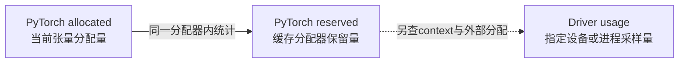
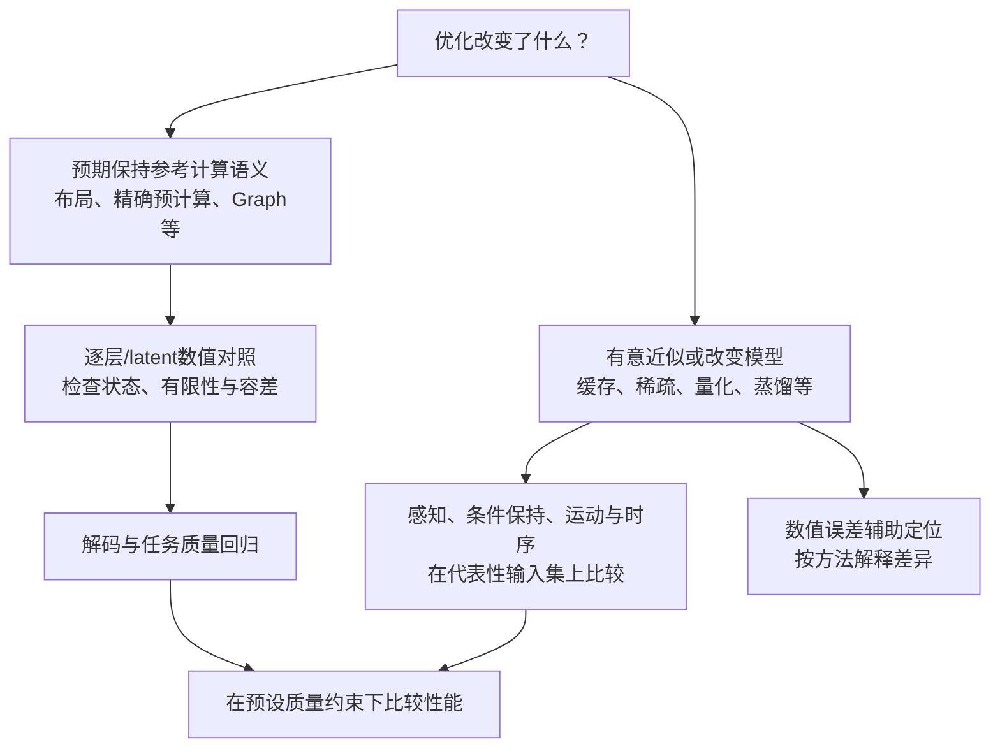

# 第5章 性能分析与可复现实验

离线单视频延迟、多请求吞吐、首帧与稳态 chunk 间隔会导向不同方案。先确定目标和交付终点，用不插桩的原生入口建立参考，再用短 profile 解释成本。本章集中定义计时、容量和质量原则；各章的合成实验按附录 A、C 给出的硬件、Shape、样本完整性和范围阅读。

## 计时边界

Wall time 覆盖约定的 Host 和设备完成边界。CUDA Event 测量指定 Stream 的时间跨度，可能包含等待；Profiler 累计 device 时间可以跨 Stream、跨 GPU 重叠。报告中应分别命名。完整 E2E 还要写明终点是 latent、首份可播放帧、编码文件，还是客户端消费完成。

```python
# 单设备同步 wall 示例；多设备应等待全部相关完成事件。
import time
import torch
torch.cuda.synchronize()
start = time.perf_counter()
output = run_request()
torch.cuda.synchronize()
elapsed = time.perf_counter() - start
```

请求前后同步用于测完成时间；逐层同步会改变执行路径，适合诊断。CPU tensor 复制、逐层 hooks、哈希和 finite 检查也可能引入同步，应移出热计时，或明确计入了哪些成本。

## 从请求缩小到一个成本项

先按条件编码、DiT、历史更新与搬运、decoder、编码及交付划分阶段。DiT 内再查看 Linear、Attention、Norm/调制、布局转换和通信。记录 Shape、stride、dtype、调用数和实际 backend，再只改变一个因素。

例如，trace 中出现大量 H2D copy 时，先检查搬的是权重还是每步重读的活跃 KV；若是后者，就测载荷、读取次数、源内存类型和等待。第13章的合成搬运实验展示这一控制变量过程。GPU 利用率只能帮助定位空闲区间，具体优化仍需要调用路径和时间线解释。

## 配对基准与环境漂移

A/B/A 依次运行参考 A1、候选 B、参考 A2。固定权重、输入、初始噪声、采样配置、硬件和计时范围，保留各臂的 warmup 与全部热样本。参考复测可以暴露背景负载、频率和温度变化，但三臂顺序本身不消除这些干扰。

以首轮基线 $T_{A1}$ 为分母计算前后漂移。结果为正，说明末轮基线 $T_{A2}$ 变慢，可能出现了降频或背景干扰：

$$\mathrm{Drift}_{A2/A1}=\left(\frac{T_{A2}}{T_{A1}}-1\right)\times100\%$$

$$\mathrm{Speedup}=\frac{(T_{A1}+T_{A2})/2}{T_B}$$

局部倍率以两次参考均值的平均为分子，候选均值为分母。漂移与收益一起报告，并按预先确定的误差预算决定是否增加独立重复。连续 30 个 chunk 是一条相关序列；服务 P99 和跨场景稳定性需要独立请求与适当样本量。

加载、编译、准备、rollout、VAE 和编码分别计时。阶段严格串行且覆盖同一请求时才可相加；流式系统直接测输入到交付的关键路径、首包和稳态间隔。

## 三种显存统计



`torch.cuda.memory_allocated()` 反映当前张量分配量；`memory_reserved()` 反映 PyTorch 缓存分配器保留量，可能包括 Graph 私有池。驱动统计还可能包含 context、第三方分配和其他进程，取决于采样范围。[PyTorch allocated](https://docs.pytorch.org/docs/2.8/generated/torch.cuda.memory.memory_allocated.html)、[reserved](https://docs.pytorch.org/docs/2.8/generated/torch.cuda.memory.memory_reserved.html)分别给出了接口定义。

每张卡报告 allocated、reserved 与驱动采样峰值，注明重置和采样区间。三项峰值可能发生在不同时间；分析碎片需要分配快照、失败尺寸或池状态，而不是简单相减。Host RSS 另行记录。

## 按方法选择质量检查

性能比较需要质量约束，但不同方法不适合经过同一条串行阈值链。



### 数值等价与近似误差

对预期保持语义的修改，检查 dtype、比较位置、max absolute error、Relative L2、有限性与状态更新。浮点归约次序变化也可能产生微小差异，因此容差要按实现预设。只有逐位相同才记 bitwise。

$$\text{Rel-L2}=\frac{\|Z_{\mathrm{candidate}}-Z_{\mathrm{reference}}\|_2}{\|Z_{\mathrm{reference}}\|_2}$$

零范数分母单独处理。对蒸馏学生、跨步缓存或量化等近似方法，这个量可定位误差从何处开始增长，阈值需与方法和任务一起校准。它不应成为感知评估之前的一道通用淘汰线：模型改变、轨迹分叉后，较大的 latent 距离可能仍对应可接受的视频。

PSNR、SSIM 和逐帧 LPIPS 适合有空间对应关系的配对输出。蒸馏学生生成的运动或构图可以与 teacher 不同，此时逐像素比较会惩罚有效的生成差异。应同时采用提示词/条件保持、细节、运动幅度、时序一致性及人工配对评估；在固定输入集上报告质量分布和失败比例。

### 时序重投影误差

令 $p=(x,y)$ 为第 $t+1$ 帧的位置，后向光流 $F_{t+1\to t}(p)$ 指向第 $t$ 帧的对应位置，以双线性采样重建：

$$\hat I_{t+1}(p)=I_t\!\left(p+F_{t+1\to t}(p)\right)$$

令 $m(p)\in\{0,1\}$ 保留可见且采样有效的位置，$C$ 为颜色通道数，有效区域的平均绝对误差为：

$$E_{\mathrm{temp}}=\frac{\sum_p m(p)\,\|I_{t+1}(p)-\hat I_{t+1}(p)\|_1}{C\sum_p m(p)}$$

固定光流估计器、像素值范围、遮挡规则和聚合方式；空 mask 单独报告。使用 `grid_sample` 时将源像素坐标转成归一化网格，并固定 `align_corners`。[接口定义](https://docs.pytorch.org/docs/2.8/generated/torch.nn.functional.grid_sample.html)采用输出位置到输入坐标的映射。

这个残差用于诊断运动补偿后的不一致。过度静止或模糊也会得到小残差，因此还要观察实际运动和细节。AR 应按 chunk 位置统计，并覆盖窗口填满、多次淘汰和长期运行；基线自身的退化也作为质量问题记录。

联合 AV 任务另外测音频内容、音质、PTS 连续性和语义同步；纯视频将音频项记 N/A。时间戳连续、媒体可解码和感知质量分别验收。

## 让结果支持相应结论

| 材料 | 直接支持的判断 | 下一步验证 |
|---|---|---|
| 代数与源码 | 工作量、执行路径、修改位置 | 实际 dispatch、耗时和质量 |
| 合成 Kernel 实验 | 指定 Shape 的局部数值与时间 | 模型内转换、系统成本与输出 |
| 整模配对 | 指定输入的执行、状态和计时 | 代表性场景的感知质量与交付 |
| E2E 与质量评估 | 指定任务集的交付表现 | 其他硬件、分辨率和服务负载 |

保存负结果有助于下一次决策：记录哪里变慢、哪项质量下降、哪些范围尚未测量。合成 ring 略慢就保留这项结果；需要改变历史提交协议的候选，则作为算法变化重新验证，而不是归入精确系统优化。

