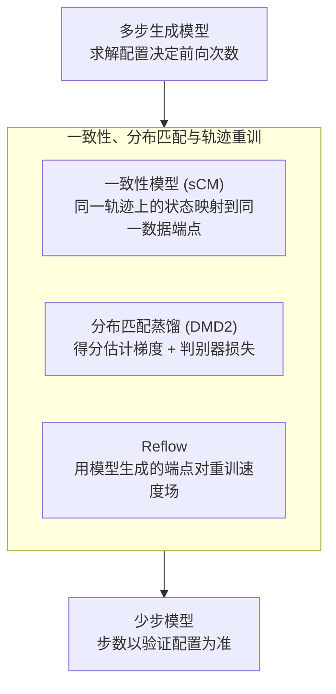

# 第6章 减少网络求值：求解器、少步、CFG 与蒸馏

NFE（Number of Function Evaluations）统计被计数函数的求值次数。论文可能计 ODE 右端函数，工程日志则可能计实际 model call；有 CFG 时两者未必相等。把正负分支拼成 $2B$ 批大小后，虽然只发起一次 `model()` 调用，仍要执行两份分支工作。因此实验应同时报告 scheduler 更新数、denoise model calls、每次调用的 batch/CFG 分支和额外 refresh；统计工作量时，分支倍数只计一次。

在相同积分区间减少步数，会增大部分步长 $\Delta t$。截断误差、网络预测误差与引导强度共同影响采样结果；更少的步数并不自动保留质量。本章分别讨论高阶求解器、时间网格重映射和少步蒸馏。

## 求解器怎样减少求值

### 概率流 ODE 与截断误差

[Song 等人的 SDE 框架](https://arxiv.org/abs/2011.13456v2)在相应正则和 score 假设下，构造与扩散 SDE 具有相同时间边缘分布的概率流 ODE。对漂移 $f(x_t,t)$ 与仅依赖时间的标量扩散系数 $g(t)$，其形式为：
$$\mathrm{d}x_t = \left[ f(x_t, t) - \frac{1}{2} g(t)^2 \nabla_{x_t} \log p_t(x_t) \right] \mathrm{d}t$$
对满足相应光滑性条件的确定性 ODE，一阶 Euler 法的局部截断误差为 $\mathcal{O}(\Delta t^2)$，全局误差为 $\mathcal{O}(\Delta t)$。随机 SDE 的 Euler-Maruyama 需另行分析；采样步数取决于速度场、调度器与质量目标。

[DPM-Solver++](https://arxiv.org/abs/2211.01095v1)利用扩散 ODE 的半线性结构，解析处理线性项，对数据预测网络对应的积分项构造高阶近似。[UniPC](https://arxiv.org/abs/2302.04867v1)将 predictor 与 corrector 统一起来，并利用已有预测提高阶数；其 corrector 不要求额外的模型求值。多步法复用历史预测，因此应沿实际算法统计求值次数；启动阶段、历史长度和最后一步处理仍要看实现。

在相应光滑性、稳定性和启动条件下，二阶法的局部误差可为 $\mathcal{O}(\Delta t^3)$、全局误差为 $\mathcal{O}(\Delta t^2)$。误差阶数不直接保证生成质量，仍须在同一模型与调度设置下配对验证。

### 流匹配（Flow Matching）与速度场

Flow Matching 通过回归给定概率路径的速度场来训练生成模型，允许多种路径，也包含 diffusion 路径。本节以 FLUX.1、Wan2.1、SD3 等模型常用的直线条件路径为例，说明速度场与采样方向。[原论文§4](https://arxiv.org/html/2210.02747v2#S4)

#### 速度场定义

取噪声先验 $p_1 = \mathcal{N}(0, I)$ 与真实数据分布 $p_0$，直线条件路径写作：
$$x_t = (1 - t) x_0 + t x_1, \quad t \in [0, 1]$$
对一对固定端点，其条件速度目标为：
$$u_t(x_t\mid x_0,x_1)=\frac{\mathrm{d}x_t}{\mathrm{d}t}=x_1-x_0$$
但网络只看到 $x_t,t,c$，并不知道这对端点。在平方误差目标下，它拟合的是条件期望：
$$v_t(x,c)=\mathbb{E}[x_1-x_0\mid x_t=x,c]$$
不同样本路径可能经过同一位置。条件路径是直线，不代表边缘速度场的积分轨迹也是直线。本节取 $t=1$ 为噪声端，采样从 1 向 0 积分；若模型用相反时间方向，速度符号也要随之变换。依据见[Flow Matching 原论文§3](https://arxiv.org/html/2210.02747v2#S3)。

#### 时间网格的 Shift

固定求值预算时，时间网格决定把计算花在哪些噪声区间。下面的 shift 映射可见于[Wan2.1 的 Flow UniPC 实现](https://github.com/Wan-Video/Wan2.1/blob/76e9427657c74f7d063f6c50fce9529900c59e28/wan/utils/fm_solvers_unipc.py)，但不是所有 scheduler 共用的公式：
$$t_{\text{shifted}} = \frac{s \cdot t}{1 + (s - 1) \cdot t}$$
当 $s>1$ 时，内部网格点被映射到更大的 $t$，端点 0 和 1 不变。在本节噪声端为 1 的约定下，时间点更偏向高噪声区域。位移并未减少 model calls，也不保证轨迹更直。参数与分辨率之间没有可通用套用的缩放律，应沿用 checkpoint 的训练/验证配置；改变 shift 属于需要配对质量验证的采样改动。

## 少步训练：一致性、分布匹配与 Reflow

当生成步数压低至 1~8 步时，直接放大步长可能无法维持质量。蒸馏与轨迹重训是常用路线，具体支持步数以 checkpoint 的验证配置为准。

[Reflow](https://arxiv.org/abs/2209.03003)用现有模型生成的端点对重训速度场，目标是逐轮减小轨迹弯曲，使粗时间网格更易近似。它改变训练数据配对与速度场，不是仅更换推理求解器；是否还需进一步蒸馏取决于目标步数和质量。

### 连续时间一致性模型（sCM）

一致性映射的理想目标是让同一概率流轨迹上的状态指向同一数据端点。省略条件，并用本节的 0/1 端点记号，可示意为：
$$f_\theta(x_t, t) = f_\theta(x_{t'}, t') = x_0$$

实际模型通过训练近似这个目标，不会对任意样本严格满足等式。一步推理直接从噪声预测数据，多步采样则按匹配的加噪与预测协议校正。sCM 使用自己的 TrigFlow 参数化，上式仅示意一致性约束，完整时间坐标和损失见[sCM 原论文](https://arxiv.org/html/2410.11081v1)。

### 分布匹配蒸馏

[原始 DMD2 论文](https://arxiv.org/abs/2405.14867v2)提出改进分布匹配蒸馏的训练方法，并支持经匹配训练的多步采样；具体视频 checkpoint 的目标、任务和调度以对应模型卡及源码为准。

DMD2 用 teacher 的 real score 与学习到的 fake score 估计分布匹配梯度，采用双时间尺度更新改善 fake critic 估计，同时用真实数据的 GAN 监督补充 teacher score，并移除先前 DMD 所需的配对回归损失。

部署时，学生的时间表、shift、引导及步数应匹配其训练和验证配置。支持多步的 checkpoint 按已验证入口运行，调整步数后重新评估质量。

## CFG 单分支蒸馏与动态引导

Classifier-Free Guidance（CFG）通过显式组合有条件预测与无条件预测强化提示词相关性：
$$v_{\text{guided}} = v(x_t, t, \emptyset) + w \cdot \left[ v(x_t, t, c) - v(x_t, t, \emptyset) \right]$$
其中 $w$ 为引导系数。实际执行双分支时，可以分开前向或打包 batch；相对等成本单分支的求值工作增加，具体调用数、wall time 与峰值显存按原生实现记录。

### 引导蒸馏（Guided Distillation）

一种实现是把 $w$ 编码为 guidance condition，再让学生拟合 teacher 的组合预测。下面只是回归目标示意；guidance 如何注入、是否支持可变 $w$，按具体 checkpoint 的接口核对：
$$\mathcal{L}_{\text{CFG}} = \mathbb{E} \left\| v_{\text{student}}(x_t, t, c, w) - v_{\text{guided}}^{\text{teacher}}(x_t, t, c, \emptyset, w) \right\|_2^2$$

* **推理收益**：若 checkpoint 已将引导行为蒸馏进单分支，并按其接口传入所需的 guidance 条件，可省去外部双分支组合。等成本分支求值数可减半；wall time 与峰值显存不保证减半；
* **接入时检查**：检查权重、guidance embedding 与原生调用协议。直接在未蒸馏模型上设 `cfg_scale=1.0` 会改变引导行为，需要重新评估提示词保持和画质。

### 单分支动态早退候选（Negative Early-Exit）

可以研究在部分去噪步关闭无条件分支，但这改变 CFG 计算，属于需质量验收的近似候选；APG 等方法则需要按各自的引导公式分析。

* **示例前 6 步**：保留双分支，共 12 次分支求值；
* **示例后 14 步**：令 $w=1$，只计算条件分支，共 14 次求值。

20 步合计 $12+14=26$ 次分支求值，而全程双分支为 40 次，分支求值工作少 35%。这只是**等成本分支的算术示例，非实际 model call 数、系统耗时或 PSNR/CLIP 实测**；分支打包、调度开销与质量差异应另测。

## Wan2.2：把步数还原为实际工作

在[固定 T2V 入口](https://github.com/Wan-Video/Wan2.2/blob/1ea34ff48f87168174e12956e200b1d908b1c5ff/wan/text2video.py)中，UniPC 和 DPM++ 分别构造自己的时间表；循环中每个时间点选一个 expert，并执行两次条件分支前向。令高噪声区间有 $S_h$ 个时间点、低噪声区间有 $S_l$ 个时间点，则该路径调用数为 $2(S_h+S_l)$，由两个 expert 承担 $2S_h$ 和 $2S_l$ 次。

改变 shift 还可能改变各时间点落在哪一 expert 一侧。减少总步数后，应同时记录两个 expert 各自的执行数、驻留/切换和质量，将实际调用数和各阶段耗时一起比较。这项源码计数确定 benchmark 的工作量分母；对应延迟需要在所选权重和硬件上测量。

## 从双向 teacher 到少步 AR：CausVid 与 Self Forcing

CausVid 同时改变信息可见范围和采样步数。学生使用 block-causal Attention，同一 chunk 内可并行，后面的 chunk 只依赖已生成历史。训练先用 teacher 的 ODE 轨迹初始化学生，再用分布匹配蒸馏微调；teacher 保持双向上下文，为因果学生提供视频级监督。因此“换成因果 Mask”和“把步数改成 4”都不足以复现该模型，需要配套训练权重。[CausVid 论文§4](https://arxiv.org/html/2412.07772v4)

Self Forcing 进一步针对训练与推理的历史分布差异：训练时按 AR 顺序生成视频，并让后续 chunk 读取模型自己生成的历史 KV。视频级分布匹配损失作用于这些生成序列；少步主干和随机梯度截断控制训练成本。训练时始终读取真实历史的模型，在推理中会遇到自身错误积累，单块重建误差很小也可能逐块漂移。[Self Forcing 论文§3](https://arxiv.org/html/2506.08009v2#S3)

部署时可沿三条线检查。首先是实际去噪时间表与 CFG，二者决定每块求值预算。其次是历史提交：固定的 [Self Forcing 推理代码](https://github.com/guandeh17/Self-Forcing/blob/7b27679bb0a30603a9a6520030474b6ef62d86dd/pipeline/causal_inference.py)在去噪后还以指定的 context noise 更新 KV。最后是长程窗口：其 [causal Attention 实现](https://github.com/guandeh17/Self-Forcing/blob/7b27679bb0a30603a9a6520030474b6ef62d86dd/wan/modules/causal_model.py)区分全局与局部索引，并支持保留 sink、滚动淘汰较早的其他历史。配置中的 sink 大小、窗口、位置编码与所用权重一起验证；环形淘汰可以限制历史存储量，长视频中的角色与场景能否持续保持，还取决于模型训练时见过的历史分布。

把这些工作分清，才容易判断剩余成本。假设某个协议每块 4 次去噪、1 次上下文更新，且五次等成本，后者就占主干调用的 20%。这是独立算术例。真实上下文更新还写历史，耗时需要单独测。若想省去它，先证明最后一次去噪所用状态与应提交状态相同，或使用专门为其他上下文协议训练的模型。[第12章](12-ar-state.md)继续讨论状态读写。

比较 student 与 teacher 时，按第 5 章的近似方法路径评估质量，重点观察条件保持、运动和长程漂移。

## 如何验证采样改动

固定权重、任务、分辨率、帧数、seed 和初始噪声，先保存原生时间表与分支日志，再改变一种采样因素。比较实际网络调用、每次 batch、可见历史、总 DiT 耗时、完整交付和质量。更换蒸馏 checkpoint 时明确记录权重变化；不要把 teacher 与 student 的差值都归因于 solver。

少步后 Kernel Launch、位置准备、历史搬运和 VAE 占比可能上升。新的瓶颈需要重新 profile，而不是继续按原有主干比例外推。步数、缓存和精度组合的最终结果在[第16章](16-composition-and-validation.md)按配对实验判断。
