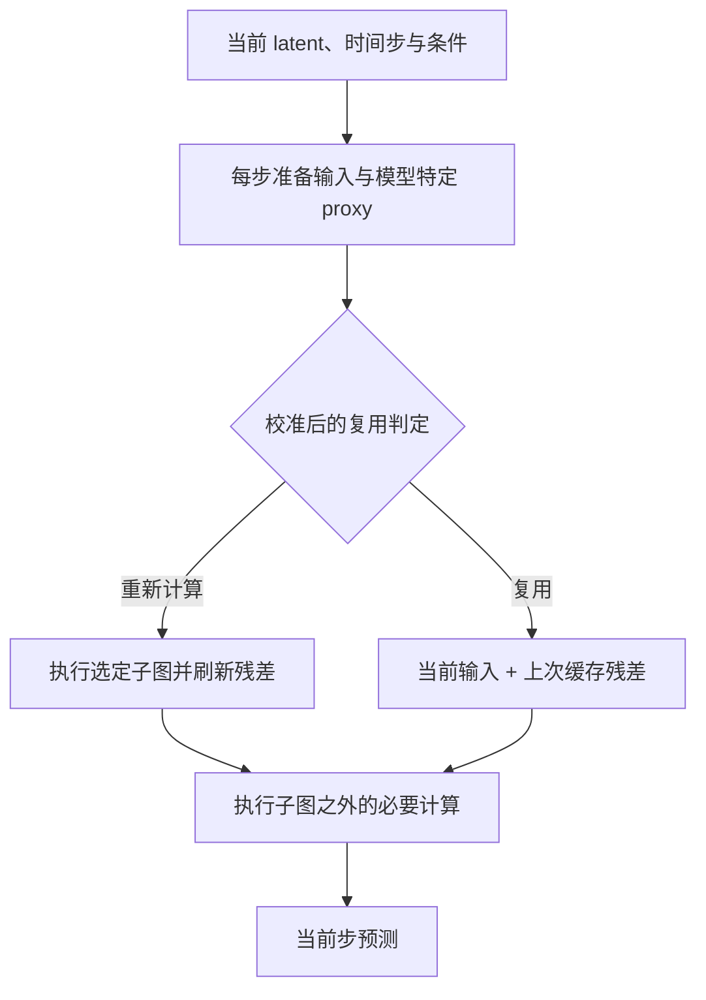

# 第7章 跨步特征复用与自适应缓存

跨步特征复用利用相邻去噪状态的相似性，近似跳过某段网络。收益来自减少实际执行的 block 或子图，不一定减少 scheduler 更新数或外层 model API 调用。将它与原生去噪路径比较，同时检查缓存误差、历史状态和最终视频。

## 跨步相似性：经验依据与误差边界

[TeaCache 论文](https://arxiv.org/html/2411.19108v2)观察到其测试模型的输出变化随去噪阶段而变，并用输入侧代理估计是否复用。可缓存的子图、需要保留的计算与有效阈值仍由模型适配决定。



Taylor 展开可以帮助理解局部复用的条件。设 $h(t)$ 为沿某条去噪轨迹的特征，$\Delta t$ 为相邻时间步差：

$$h(t-\Delta t)=h(t)-\Delta t\,h'(t)+R_2$$
$$\sup_s\|h''(s)\|\le M\quad\Longrightarrow\quad
\|R_2\|\le \frac{M\,\Delta t^2}{2}$$

这个上界要求区间内的二阶导数约束；只看某一点的一阶变化还不足以确定 $M$。轨迹、调度器或条件变化后，局部误差还可能随后续迭代传播。

## TeaCache：模型特定代理与工程边界

### 判定指标与校准

TeaCache 用低于完整主干成本的输入侧代理，估计输出变化并累计决策量，而不是先得到本步真实输出。论文包含 timestep modulation 和 rescaling，具体 proxy 的 Shape 和提取路径要沿模型适配检查。官方代码以下链接固定于 `7c10efc4702c6b619f47805f7abe4a7a08085aa0`：

- [HunyuanVideo 适配](https://github.com/ali-vilab/TeaCache/blob/7c10efc4702c6b619f47805f7abe4a7a08085aa0/TeaCache4HunyuanVideo/teacache_sample_video.py)：对图像 token 输入做首个 double block 对应的 norm/modulation，比较该特征张量，随后使用多项式 rescaling；命中时复用图像残差并绕过其实现中的 double/single block 计算，跳过范围由该适配路径确定；
- [Wan2.1 适配](https://github.com/ali-vilab/TeaCache/blob/7c10efc4702c6b619f47805f7abe4a7a08085aa0/TeaCache4Wan2.1/teacache_generate.py)：根据配置采用时间嵌入 e 或投影后的 e0，使用匹配型号/任务的系数，并分别维护 conditional/unconditional 状态；保留步与截止步也由适配决定。

抽象地，$p$ 为适配器选定的 proxy tensor，$g$ 为模型特定的重标定函数，$\epsilon$ 为分母保护值，$\tau$ 为待校准阈值：

$$p_t=P_{\mathrm{model}}(x_t,t,c)$$
$$d_t=\frac{\operatorname{mean}|p_t-p_{\mathrm{prev}}|}
{\max(\operatorname{mean}|p_{\mathrm{prev}}|,\epsilon)}$$
$$S_t=S_{\mathrm{prev}}+g_{\mathrm{model}}(d_t)$$

$c$ 为条件。缓存有效且 $S_t<\tau$ 时才考虑复用，否则重新计算并重置累计量。

分母保护是这里建议的数值防护，不声称所有官方版本均已实现。$g$、$\tau$、强制重算步和跳过范围需要与模型、权重、分辨率、调度器及步数一起核验；新模型应重新校准阈值。proxy、归约、读写和 host 决策开销也须计入，特别是低 NFE 配置可能几乎没有可复用步。

### 残差缓存的显存账本

只作算术例：batch $B=1$、序列 $N=50,000$、宽度 $D=4096$、BF16 每元素 2 bytes：

残差 Shape 为 `[B,N,D]`，其载荷为：

$$M_{\mathrm{residual}}=BND\times2
=409{,}600{,}000\ \mathrm{B}=409.6\ \mathrm{MB}\ (390.625\ \mathrm{MiB})$$

40 份同形状张量合计 16.384 GB（15.259 GiB），未计其余开销。

完整容量账本的计算方法见[第4章](04-memory-and-state.md)，量化表示见[第10章](10-gemm-and-quantization.md)。即使一个单输入/单输出子图可缓存为 `residual = output - input`，这份残差的载荷之外还要计入其他活跃对象。

完整账本还包括上一 proxy、输入快照、额外条件/CFG 分支、权重、活跃激活、输出与临时 workspace；峰值可能同时持有旧缓存和新结果。双流或有副作用的子图还需处理其他输出与状态，按生产者和消费者实际访问的张量逐项核算。

### 一个残差缓存骨架

下面用接口伪代码说明缓存状态的组织。假设 adapter 提供 `prepare/proxy/region/finish/rescale`，`rescale` 返回单元素 tensor，其中 region 是**无额外状态副作用、输入输出同形状**的单张量子图；多流、历史 KV 写入、条件更新等需要专用适配。`rescale` 的负值或非有限结果在此示例中保守触发重算，该策略也需校准。

```python
import math
import torch

@torch.no_grad()
def concept_step(adapter, x, t, cond, state, key, *, threshold,
                 max_skip, force_compute=False, eps=1e-6):
    # key变化即reset；同一个state只服务一条有序去噪轨迹/一个CFG分支。
    if "key" not in state or state["key"] != key:
        state.clear()
        state.update(key=key, prev_mod=None, residual=None, accum=0.0, skips=0)
    h = adapter.prepare(x, t, cond)
    mod = adapter.proxy(h, t, cond).detach().float()
    prev = state["prev_mod"]
    score = math.inf
    if prev is not None and prev.shape == mod.shape and prev.device == mod.device:
        denom = prev.abs().mean().clamp_min(eps)
        delta = (mod - prev).abs().mean() / denom
        score = float(adapter.rescale(delta).item())  # GPU->host决策可能同步
    candidate = state["accum"] + score
    residual = state["residual"]
    compatible = (residual is not None and residual.shape == h.shape
                  and residual.dtype == h.dtype and residual.device == h.device)
    reuse = (not force_compute and compatible and math.isfinite(candidate)
             and score >= 0 and candidate < threshold and state["skips"] < max_skip)
    state["prev_mod"] = mod.clone()  # 每步更新，而不是只在重算时更新
    if reuse:
        h = h + residual
        state["accum"], state["skips"] = candidate, state["skips"] + 1
    else:
        h_in = h.detach().clone()  # region可能原地更新h，不能只保存别名
        h = adapter.region(h, t, cond)
        new_residual = (h - h_in).detach().clone()
        if not torch.isfinite(new_residual).all().item():
            raise FloatingPointError("non-finite cache residual")
        state["residual"] = new_residual
        state["accum"], state["skips"] = 0.0, 0
    return adapter.finish(h, t, cond)
```

该骨架的阈值、最大连续跳步与强制重算策略均由调用者提供，不构成误差上界。部署前还需补齐：

- **身份与生命周期**：key 覆盖模型/adapter 版本、请求与条件、CFG 分支/强度、shape、dtype、device、调度配置；换请求/权重/条件须 reset，首步、末步和步序跳转按适配策略重算。AR chunk、相机或历史 KV 版本变化时，按模型协议失效缓存；
- **数值与性能**：ε、非有限值及输出检查需要明确定义；`.item()`、Python 分支、FP32 proxy、clone 和缓存加法都有成本，静态 CUDA Graph 需要另行改写这些 Host 决策；
- **状态正确性**：验证 batch/CFG 布局、mask、位置编码、额外输出和 clean refresh；记录命中、重算次数、峰值与质量。`max_skip` 限制连续复用长度，由质量评估确定。

## Wan2.2：区分 expert 与 CFG 状态

固定 T2V 入口具有两份 expert 与两个 CFG 分支。缓存身份至少要包含当前 expert、条件分支、权重/adapter、Shape 和采样配置。跨 boundary 后网络权重改变，即使 latent 形状相同，也应使用对应 expert 的缓存状态。[expert 选择源码](https://github.com/Wan-Video/Wan2.2/blob/1ea34ff48f87168174e12956e200b1d908b1c5ff/wan/text2video.py)

将 TeaCache 的 Wan2.1 适配迁到 Wan2.2 时，应核验 proxy、重标定系数、强制重算区间和跳过范围，统计两个 expert 的实际 block 执行数。接入前先完成该配置的校准，再对照未缓存路径测整模延迟和质量。

## AR：chunk 边界也是输入变化

连续 AR 每推进一块，会更新历史、局部位置和相机条件。相邻 chunk 不是同一条去噪轨迹的相邻时间点；默认应重置跨步缓存，只有专门验证过的跨 chunk 算法才允许其他策略。clean refresh 还承担状态写入，应放在无副作用残差缓存之外。

在 4 步去噪中，首尾保留和强制重算后可能只剩很少复用机会。应计算 proxy、归约、host 决策、缓存读写与峰值的完整成本，再决定是否值得整模接入。低 NFE 的 AR 应优先筛选剩余复用机会是否足以覆盖这些固定成本。

## 同时测执行次数、延迟和质量

至少记录每步的复用/重算决策、实际执行 block 数、缓存有效期和额外内存。对齐未缓存参考，检查细节、运动、条件保持及后续误差；AR 还要跨多次历史淘汰运行。命中率用于解释实际少执行了多少工作；采用判断以延迟和质量为准。

固定条件侧的精确预计算见[第11章](11-fusion-and-graphs.md)，历史 raw KV 见[第12章](12-ar-state.md)。
