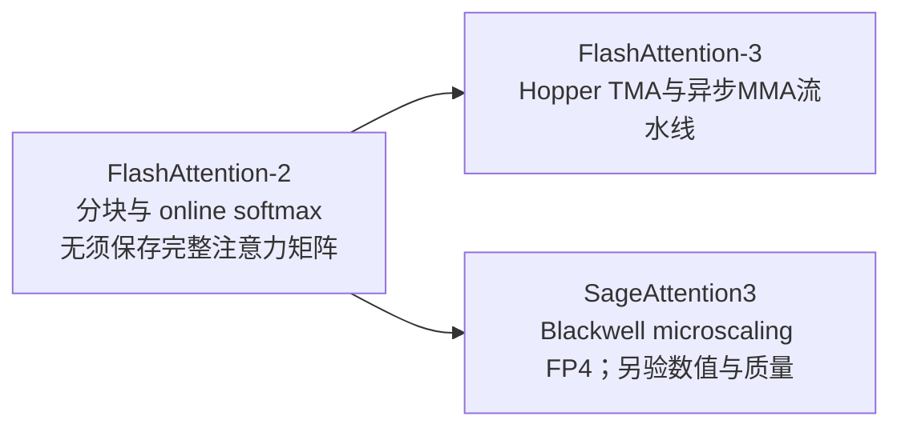

# 第8章 Dense Attention Kernel 与低精度 Attention

Flash 式 Kernel 通过分块和 online softmax 避免保存完整的 Attention 矩阵；低精度 Attention 还会改变操作数表示和舍入误差。比较两条路径时，保持 mask、Q/K/V 语义、dtype 与布局一致，并用 profiler 确认实际 dispatch。

## Dense Attention 与低精度变体

### FlashAttention-3 的流水线

[FA3 作者说明](https://tridao.me/blog/2024/flash3/)讨论 Hopper 上的 TMA、异步 Tensor Core 与调度。下面的 RTX 小例使用 PyTorch 2.8.0+cu128 内置的 SDPA flash backend，profiler 中对应 `aten::_scaled_dot_product_flash_attention`；它没有调用单独安装的 `flash-attn` Python 包。部署 FA3 或 Blackwell 专用实现时，另行检查该 Kernel 的硬件目标和版本。

#### TMA 与数据搬运

分块加载的地址生成、寄存器和 shared memory 用量会影响 occupancy。Ampere 已有异步 copy；Hopper 的 TMA 进一步使用 tensor descriptor 描述多维搬运，由专用引擎把数据送入 shared memory，减少部分地址生成与寄存器占用。线程仍负责发射指令、管理 buffer 和同步。

#### Warp Specialization 与 GEMM/softmax 交叠

Producer 提交 TMA 搬运，consumer warpgroup 执行异步 GEMM、softmax 与归一化。一个 warpgroup 包含 4 个 warp、128 个 thread。WGMMA 的 A 操作数可来自寄存器或 shared memory，B 通过 shared-memory descriptor 读取，累加器保存在寄存器中。

TMA 加载与 WGMMA 计算各有完成依赖，分别通过 barrier 和相应的 fence、commit/wait 协议管理。consumer 先等数据可读，再在使用累加结果前等待矩阵乘完成。FA3 还在 consumer 之间及 consumer 内部交叠 GEMM 与 softmax，减少非矩阵计算暴露的等待。tile 越大可能提高复用，也会增加寄存器/shared memory 压力，最终要看 occupancy 与时间线。[作者的流水线说明](https://tridao.me/blog/2024/flash3/#asynchrony-overlapping-gemm-and-softmax)、[PTX WGMMA 协议](https://docs.nvidia.com/cuda/parallel-thread-execution/index.html#asynchronous-warpgroup-level-matrix-instructions)

#### 分块结果为何仍能形成全局 softmax

对一个 query 行，把 KV 分块。块 $j$ 的 score 为 $s_j$，记录局部最大值 $m_j$、指数和 $\ell_j$ 与未归一化输出 $u_j$：
$$m_j=\max(s_j),\qquad \ell_j=\sum\exp(s_j-m_j),\qquad u_j=\exp(s_j-m_j)V_j$$
合并两块时，先统一指数基准，再相加：
$$m=\max(m_a,m_b)$$
$$\ell=e^{m_a-m}\ell_a+e^{m_b-m}\ell_b$$
$$u=e^{m_a-m}u_a+e^{m_b-m}u_b,\qquad O=u/\ell$$
这就是 online softmax 需要保留的统计量。直接相加两个局部 softmax 输出会丢失各块的相对归一化权重。FlashAttention、split-KV 与 Ring Attention 都需要等价的合并逻辑；mask、全遮蔽行及数值精度仍由具体 kernel 处理。[FlashAttention 原论文](https://arxiv.org/abs/2205.14135v2)

### FlashDecoding：沿 KV 增加并行度

当 query 很短、KV 很长，且 batch、head、query tile 提供的 CTA 不足时，可以沿 KV 增加并行度。逐 Token Decode 常有这种形状；AR-chunk 则通常一次生成千余至数千个 query token，已经具备较多 query tile。此时 split-KV 增加的并行度是否值得额外规约，要按实际 shape 测量。

#### 线程块如何划分
* **单 query 的简化映射**：若每个 batch/head 仅一个 CTA，batch1/32heads 只有 32 个 CTA，需与整卡 SM 数量及执行波次比较。长 query 的 FlashAttention 还沿 query tile 并行，可调度 CTA 数随之增加；
* **FlashDecoding 机制**：将 KV 序列切为 $S$ 个子块，各子块并行计算局部 attention 及 log-sum-exp，再按归一化权重归约。它增加可调度的线程块，也引入中间结果与规约成本；是否改善总延迟取决于 query/KV 长度、head 数、切分与硬件。[原始实现说明](https://pytorch.org/blog/flash-decoding/)

### SageAttention：量化粒度、补偿与实际 dispatch

Sage 系列把两次矩阵乘中的部分操作数转成低比特格式，以使用更高吞吐的 Tensor Core。输入接口为 FP16/BF16，不代表内部按该精度计算。下表描述论文路线，实际安装包可能提供不同变体：

| 路线 | $QK^\top$ | $\widetilde P V$ 与精度处理 |
|---|---|---|
| [Sage1](https://arxiv.org/html/2410.02367v3#S4) | INT8，比较 per-token/per-block 粒度 | 准确路径保留 FP16，可采用 FP16 accumulator；另有全 INT8 变体 |
| [Sage2](https://arxiv.org/html/2411.10958v2#S3) | per-thread INT4，并平滑 Q/K | E4M3 FP8（含 V 平滑）；用局部 MMA 结果与外部 FP32 buffer 缓解累加误差 |
| [Sage3](https://arxiv.org/html/2505.11594v3#S3) | Blackwell NVFP4 microscaling | 同样使用 NVFP4；$\widetilde P$ 另做逐行放大与微块缩放 |

$\widetilde P$ 指分块 softmax 内部尚未完成全局归一化的指数权重。Sage3 的微块包含 16 个 E2M1 值及 E4M3 scale；若很小的权重直接生成很小的 scale，scale 自身也会丢精度，因此还要逐行缩放。它与“把所有浮点张量 cast 成 FP4”不同。Sage2 的 per-thread 粒度则让 scale 安排匹配线程持有的 MMA 片段，减少更细粒度反量化带来的处理成本。

平滑的等价性可以直接检查。令 $\mu_K$ 为沿 token 轴的均值、$K_c=K-\mathbf1\mu_K$，则 $Q\mu_K^\top$ 对每个 query 行都是常数，因此：
$$\operatorname{softmax}(QK^\top/\sqrt d)=\operatorname{softmax}(QK_c^\top/\sqrt d)$$
若还令 $Q_c=Q-\mathbf1\mu_Q$，就必须补回随 key 变化的项：
$$\Delta S=\mathbf1(\mu_Q K_c^\top)$$
$$\operatorname{softmax}(QK^\top/\sqrt d)=\operatorname{softmax}((Q_cK_c^\top+\Delta S)/\sqrt d)$$
上述等式在实数运算中成立；随后量化仍有误差。$\mu_Q$ 是沿 token 轴求得的逐通道均值向量，不能照抄成全 tensor 共用一个标量均值。[Sage2 v2 的算法描述](https://arxiv.org/html/2411.10958v2#S3.SS2)在分块前对整张 $Q$ 求逐通道 token 均值，[Sage3 v3](https://arxiv.org/html/2505.11594v3#S3) 则按每个 query block（query tile）计算 $\mu_{Q_i}$；实际部署应按所选版本与 Kernel 核对平滑范围及补偿项布局。V 若减去 token 均值，则归一化输出还要加回该均值。

收益来自更快的矩阵指令，代价包括统计 scale、打包、布局转换和补偿。预处理工作量约随 $(M+N)d$ 增长，矩阵乘约随 $MNd$ 增长；长 query 更容易摊薄前处理，短 query 反复重新量化长 KV 则可能更慢。因此应同时测量前处理、Attention Kernel 与两者合计时间。

部署时应记录实际函数、GPU、layout、mask、head dimension 与累加配置。例如[固定官方 API 清单](https://github.com/thu-ml/SageAttention/blob/d1a57a546c3d395b1ffcbeecc66d81db76f3b4b5/README.md)仍有 `qk_int8_pv_fp16`、`qk_int8_pv_fp8` 变体，不能由“Sage2”名称断定该实验执行 INT4。Benchmark 应包含格式转换与 attention 总时间，另报纯 kernel 时间，并在相同输入上验数值与长片段质量。Sage3 的数值与性能仍需在目标模型上单独测量。

## Attention：同 BF16 输入，改变实际 backend

[执行脚本](../../examples/rtx_dit_lab.py)固定 Q/K/V 为 BF16 `[1,8,512,64]`、seed 42、无 mask、dropout=0。单独计算 FP32 显式 softmax 参考；性能对照为 BF16 输入的 SDPA MATH→FLASH_ATTENTION→MATH。通过计时外 CPU operator profiler 确认真实 dispatch，禁用隐式 backend 回退。

每组 5 个 warmup、30 个 hot 观测，每个观测 10 次调用；以下为每次调用均值，A 为两侧 A1/A2 均值的平均。

### 单卡 RTX 5090 结果

| 计时范围 | A1 math | B flash | A2 math | A/B |
|---|---:|---:|---:|---:|
| 含最终同步 wall，ms/call | 0.109920 | 0.026737 | 0.111824 | 4.14670× |
| CUDA stream event span，ms/call | 0.109083 | 0.025846 | 0.110901 | 4.25565× |

wall 首尾漂移 +1.733%，统计保留全部样本。A1/A2 逐位相同；B 对 A1 最大绝对差为 0.001953125，relative L2 为 0.002374836（约 0.23748%）。FP32 仅作数值参考，倍率分母始终使用 BF16 MATH。CUDA allocated 峰值为 36,835,840 B；驱动和 context 等额外内存另计。

### 数据中心 SM90 GPU 单卡结果

同一脚本与输入几何在数据中心 SM90 GPU（80 GB）上运行，使用单张卡 `cuda:0`；记录的 PyTorch 为 2.10.0、CUDA runtime 为 13.1：

| 计时范围 | A1 math | B flash | A2 math | A/B |
|---|---:|---:|---:|---:|
| 含最终同步 wall，ms/call | 0.138482 | 0.033238 | 0.138798 | 4.17112× |
| CUDA stream event span，ms/call | 0.137431 | 0.032268 | 0.137772 | 4.26431× |

wall 首尾漂移 +0.228%，CUDA event 漂移 +0.249%。A1/A2 逐位相同；B 对 A1 最大绝对差同样为 0.001953125，relative L2 为 0.002374836。在这个小 Shape 上，两套环境的 wall 倍率均约为 4.1×。两组观测均为历史样本，采集所用脚本与随包脚本的差异见[附录 B](appendix-b-reproduction.md#历史观测与随包脚本版本)。长序列、矩形 Attention 及模型内准备成本需要各自的对照，原始样本见 [measurements.json](evidence/measurements.json) 与 [measurements_sm90.json](evidence/measurements_sm90.json)。

## 从方阵到 AR 矩形 Attention

双向 self-attention 常比较 Q 和 K 长度接近的长序列，cross-attention 的文本 K 长度则另计。AR-chunk 在稳定窗口中可能是 $N_q$ 个当前 query 对 $N_k$ 个历史加当前 key；当 $N_k$ 明显更长时，Tile 覆盖、并行任务数及 KV 读取都与方阵不同。对 MHA 的乘法主项为 $4BN_qN_kHd$，softmax、变换、mask 和转换额外计算。

例如设当前块有 $N_q=4096$ 个 query，四块历史加当前块提供 $N_k=5\times4096$ 个 key；这是自包含的矩形 shape 示例。相比同样 query 长度的方阵，KV 读取量和 score 计算量都增加，query tile 数却相同。实际多模态模型还需按 reference token 和可见性重新展开布局。

## 两条主线的接入点

[Wan2.2 的 Self/Cross Attention](https://github.com/Wan-Video/Wan2.2/blob/1ea34ff48f87168174e12956e200b1d908b1c5ff/wan/modules/model.py)分别准备视频 QKV 和条件 K/V；先检查 head reshape、QK norm、RoPE 和实际 backend 的边界，再替换 Kernel。分别统计条件 cross-attention 与视频 self-attention，保留各自的调用次数和时间。

SolarWM 历史保存的是位置变换前的 raw K/V，读取时重建局部位置与相机变换。测量 Attention Core 时若排除这些变换，应同时报告包含准备成本的层级或主干计时。低精度 Kernel 的测量还包括量化粒度、scale 布局、padding、转换与临时存储，并按[第 5 章的比较类型](05-measurement.md)选择数值或感知质量评估。

接入时从一个真实层的 Q/K/V 回放开始，再扩大到完整采样：层回放定位 Kernel 和转换成本，完整采样检验误差在去噪步及未来 chunk 中的传播。
