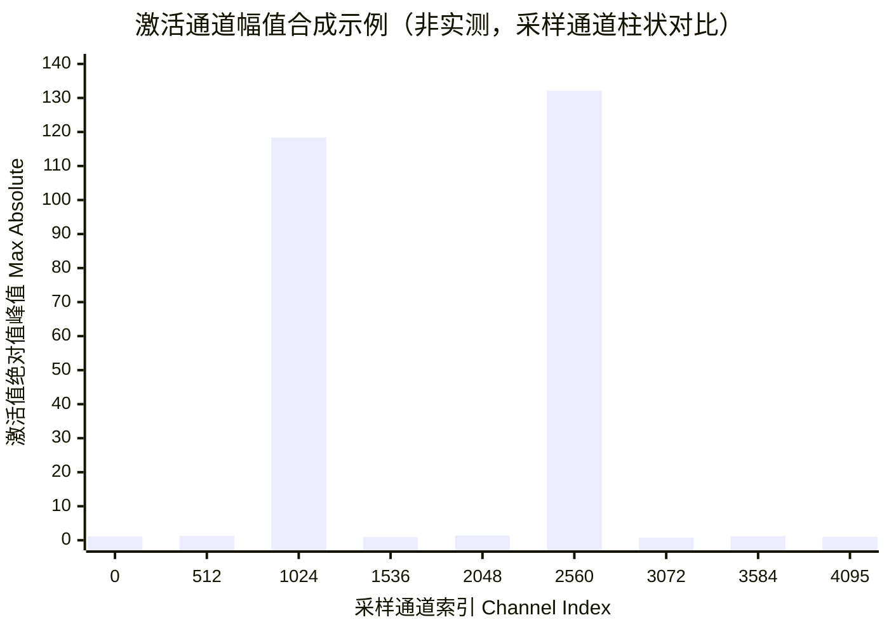
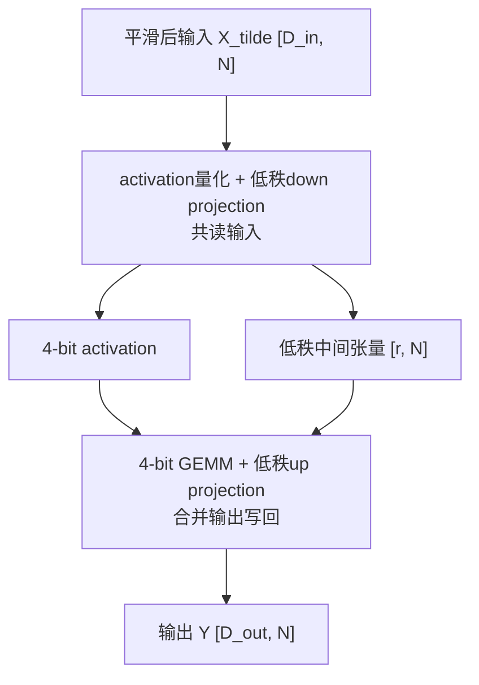

# 第10章 Linear/GEMM 与低精度计算

Linear 的耗时由 GEMM 的 $M/N/K$、布局和执行精度共同决定。Attention 融合或稀疏化以后，QKV 投影与 MLP 可能成为新的瓶颈。低精度路径要节省矩阵计算或读取时间，并覆盖量化和布局转换成本。

## 把 DiT Linear 展开成 GEMM

设 hidden states 为 $[B,N,D]$，将 batch 和序列展为 $M=B\times N$。以 Q/K/V 同宽的 MHA 为例，QKV 投影为 $[M,D]$ 乘 $[D,3D]$，输出投影为 $[M,D]$ 乘 $[D,D]$；MLP 再按原生 `ffn_dim` 展开。GQA/MQA 需按实际 KV 头数重算投影宽度，不同层的隐藏宽度与门控形式也应从配置读取。

第 3 章给出了理想算术强度。实际选型还需要确认 weight layout、transpose、bias/activation epilogue、batch 组织和 padding。小 $M$ 时压缩权重可能减少读取量，大 $M$ 时低精度 Tensor Core 可能改变计算预算；AR-chunk 的 $M$ 是当前块的有效 Token 数（常在千余至数千量级），远大于逐 Token LLM Decode 的 $M=1$，应按真实 Shape 选 Kernel。

## 浮点数据格式与硬件指令对齐

### 常见数值格式的编码与动态范围
符号位、指数位与尾数位的分配决定数值精度与表示范围：

| 格式 | 符号/指数/尾数 | 最小正数（正规 / 次正规） | 最大绝对值 | 典型硬件支持 | DiT 推理适用场景 |
|---|---|---|---|---|---|
| **FP16** | 1 / 5 / 10 | $2^{-14}$ / $2^{-24}$ | 65504 | Volta 及后续架构 | 存储与矩阵乘法；累加 dtype 由算子决定 |
| **BF16** | 1 / 8 / 7 | $2^{-126}$ / $2^{-133}$ | $3.39 \times 10^{38}$ | Ampere 及后续架构 | 基准训练与浮点推理参考 |
| **FP8 (E4M3FN)** | 1 / 4 / 3 | $2^{-6}$ / $2^{-9}$ | 448 | Ada / Hopper / Blackwell | Linear 权重与激活矩阵乘法 |
| **FP8 (E5M2)** | 1 / 5 / 2 | $2^{-14}$ / $2^{-16}$ | 57344 | Ada / Hopper / Blackwell | 梯度反向传播，推理中较少使用 |
| **NVFP4 (E2M1)** | 1 / 2 / 1 | 1 / 0.5（未计 scale） | 6.0（未计 scale） | Blackwell（如 RTX 5090 / B200） | 低比特权重与激活；需对应 scale 布局和 Kernel |

正规数包含隐含的前导 1，次正规数用更低的有效精度延伸到零附近。[OCP OFP8 规格表 1–2](https://www.opencompute.org/documents/ocp-8-bit-floating-point-specification-ofp8-revision-1-0-2023-06-20-pdf)给出的 E4M3 最小正正规数为 $2^{-6}=0.015625$，最小正次正规数为 $2^{-9}\approx1.95\times10^{-3}$；E5M2 对应为 $2^{-14}\approx6.10\times10^{-5}$ 与 $2^{-16}\approx1.53\times10^{-5}$。`torch.finfo(dtype).tiny` 返回最小正正规数，较小的次正规数应按编码或转换结果核对，二者使用不同口径。[PyTorch 类型信息](https://docs.pytorch.org/docs/2.8/type_info.html)

表中 E4M3 指有限值编码 E4M3FN，不覆盖其他同名变体。NVFP4 也不只是把数值 cast 成 E2M1：[NVIDIA 的格式说明](https://developer.nvidia.com/blog/introducing-nvfp4-for-efficient-and-accurate-low-precision-inference/)使用每 16 个值一个 E4M3 scale，再配 tensor 级 FP32 scale。因此 4-bit 载荷之外还要计算 scale 与 padding，RTX 5090 与 B200 的 Kernel 应分别按 SM120 和 SM100 编译。

还要分清存储格式与计算格式。W4A16 通常把压缩权重反量化后参与 16-bit 矩阵计算，主要可能节省权重容量与读取；W4A4、W8A8 则有机会使用对应低比特 Tensor Core，同时增加 activation 量化成本。具体路径仍以 kernel 为准。因此，报告权重位宽时也应给出实际 MMA 精度。

### 硬件 Tensor Core 的对齐与访存约束
Hopper 有原生 FP8 路径；原生 FP4 还需 Blackwell 对应硬件与 kernel。使用低精度 Tensor Core 时要核对所选指令的几何与布局约束：
* **矩阵维度对齐**：对于 $C = A \cdot B$，应核对具体 MMA 指令和 kernel 对 $M,N,K$、打包及 scale 粒度的要求，按所用 Kernel 列出支持条件；
* **内存布局要求**：Shared Memory 的 swizzle、padding 与重排由具体实现决定。部署时记录实际 kernel、支持形状及不支持输入的处理路径。

### Hopper → Blackwell：算子迁移核对表

SM90、SM100 和 SM120 的指令与资源预算不同，迁移时应分别选 Kernel：

| 项目 | Hopper SM90 | Blackwell SM100（如 B200） | Blackwell SM120（如 RTX 5090） |
|---|---|---|---|
| MMA 与累加位置 | 常见优化路径为`wgmma.mma_async`，累加器占 register | `tcgen05.mma`与 TMEM 改变累加器和流水布局 | 窄精度走 warp 级`mma.sync`系列；不沿用 SM100 的 TMEM 路径 |
| TMA 与异步搬运 | 引入 tensor descriptor 与`mbarrier`，支持 global/shared 异步搬运 | 扩展搬运模式；按具体 PTX 指令及 target 核对 | 支持 TMA；扩展模式按具体指令与 target 核对 |
| Microscaling | FP8 与软件 scale 处理；无 Blackwell 原生 block-scaled FP4 路径 | 支持对应 block-scaled FP4/FP8 指令 | 同样有原生 block-scaled 窄精度能力，MMA 和 scale 布局需匹配 SM120 实现 |
| 统一 L1/SMEM 池 | 每 SM 256 KiB | 每 SM 256 KiB | 每 SM 128 KiB |
| 可配置 Shared Memory 上限 | 每 SM 228 KiB、每 Block 上限 227 KiB | 每 SM 228 KiB、每 Block 上限 227 KiB | 每 SM 100 KiB、每 Block 上限 99 KiB；同一 Tile 与 stage 数可能装不下 |
| Triton 版本边界 | 检查所用 Kernel 的 WGMMA/TMA lowering | 检查`dot_scaled`、TMEM 与流水实现 | 3.6.0 发布说明明确新增原生 FP4/MXFP8 scaled dot 及 TMA Gather4；需使用包含对应支持的版本 |

TMA 负责搬运，TMEM 保存矩阵运算的中间结果；迁移时记录具体指令、编译 target 和 CUDA/Triton 版本，比“TMA 2.0”这样的概称更有用。关于 SM120 的 Shared Memory 口径，Blackwell Tuning Guide 曾笼统提及每 SM 128 KiB（统一数据缓存池总容量），而 CUDA Programming Guide 的 Compute Capabilities 表进一步区分了 128 KiB 统一池、每 SM 100 KiB 可配置 Shared Memory carveout 上限以及单 Block 99 KiB 上限（每 Block 另有 1 KiB 系统保留）；实际估算 tile 与 pipeline stage 空间时，应以目标设备的 `cudaDeviceGetAttribute` 查询结果和 Kernel 编译资源报告为准。NVFP4 的每 16 值 E4M3 scale 与 MX 格式的每 32 值 E8M0 scale 也需分开处理。表中 Triton 3.6.0 说明新功能的版本边界；[RTX 教学环境锁文件](../../requirements/rtx-lab-py310-cu128.lock.txt)固定的是 PyTorch 2.8.0+cu128 与 Triton 3.4.0。升级工具链后，重新检查 PTX/SASS、转换成本、资源占用与配对误差。[Hopper 指南](https://docs.nvidia.com/cuda/archive/13.0.2/hopper-tuning-guide/index.html)、[Blackwell 指南](https://docs.nvidia.com/cuda/archive/13.0.2/blackwell-tuning-guide/index.html)、[CUDA Compute Capabilities](https://docs.nvidia.com/cuda/cuda-programming-guide/05-appendices/compute-capabilities.html)、[CUTLASS SM100/SM120 实现](https://docs.nvidia.com/cutlass/latest/media/docs/cpp/blackwell_functionality.html)、[Triton 3.6.0 发布说明](https://github.com/triton-lang/triton/releases/tag/v3.6.0)

## 激活离群点如何损失量化分辨率

粗粒度量化可能无法同时覆盖离群值和普通值。离群通道是需要检查的一种误差来源；若出现偏色、噪点或结构变化，还需分别检查权重量化、累加精度和校准分布。

### 离群点的时空与通道分布
应按模型、层、输入与时间步采样激活，检查普通通道与离群通道的幅度差异，以及离群位置是否稳定。下图用合成的 4096 维数据解释 per-tensor scale 的风险；实际离群通道的比例与位置由逐层采样确定。

### 一个 Per-Tensor 量化算例
在 Per-Tensor 量化中，整个矩阵共享唯一的缩放因子（Scale Factor）$S$：
$$S = \frac{\max(|X|)}{q_{\max}}$$
以有符号 4-bit 量化为例（$q_{\max} = 7$），若矩阵中存在一个离群值 $\max(|X|) = 112$：
$$S = \frac{112}{7} = 16$$
量化公式为：
$$Q(x) = \text{clamp}\left( \left\lfloor \frac{x}{S} \right\rceil, -8, 7 \right)$$
对于占绝对多数的平常特征（$x \in [-1.5, 1.5]$）：
$$\frac{x}{S} \in \left[ -\frac{1.5}{16}, \frac{1.5}{16} \right] \approx [-0.09375, 0.09375]$$
这些值舍入后都变成 0，反量化也无法恢复其差异。这里的误差发生在舍入阶段：共享 scale 太大，小幅值信息落入同一个量化区间。实际质量影响取决于这些通道及后续计算，可用逐层回放定位敏感层。

## 分块量化与低秩补偿

### 细粒度 Block-wise FP8 量化
分块量化将全局 scale 拆成局部 scale，使一个区域的离群值不再决定其他区域的量化分辨率：

* **分块规格**：128 元素是一种候选粒度；一维分组与二维 tile 的 scale 布局不同，须与所选 kernel 配套；
* **计算流（E4M3 示意）**：
  $$X_{\text{FP8}} = \text{cast}_{\text{FP8}}\!\left(\text{clamp}\left(\frac{X}{S_{\text{block}}},-448,448\right)\right), \quad \hat X = S_{\text{block}} X_{\text{FP8}}$$
  scale 计算需处理全零块；cast 包含舍入，单纯 clamp 并未完成 FP8 编码。
* **布局与实际成本**：128 个 FP8 元素的载荷为 128 字节；另计 scale、对齐和重排，并检查 warp 实际发出的访存事务；
* **校准范围**：覆盖目标分辨率、提示词及去噪区间；按模型和输出任务制定精度阈值。

### SVDQuant：4-bit 奇异值低秩分解
SVDQuant 先把 activation 的离群幅度转移到 weight，再用高精度低秩分支吸收 weight 中的大奇异分量；分解对象是平滑后的权重。以下按列向量记号重写[原论文§4.2](https://arxiv.org/html/2411.05007v3#S4.SS2)，省略 bias。

设 $X\in\mathbb R^{D_{\text{in}}\times N}$、$W\in\mathbb R^{D_{\text{out}}\times D_{\text{in}}}$，选择正对角平滑矩阵 $S$：
$$\widetilde X=S^{-1}X,\qquad \widetilde W=WS,\qquad WX=\widetilde W\widetilde X$$
增大离群 activation 对应的 scale 会缩小该输入通道，同时放大对应 weight 列。对 $\widetilde W$ 做截断 SVD，取 rank 为 $r$ 的 $L_1L_2^\top$，再定义剩余权重：
$$R=\widetilde W-L_1L_2^\top$$
其中 $L_1\in\mathbb R^{D_{\text{out}}\times r}$、$L_2\in\mathbb R^{D_{\text{in}}\times r}$。低比特路径处理 $R$ 与 $\widetilde X$，高精度路径保留低秩项。用 $\mathcal D_4(A)$ 表示 4-bit 量化再反量化后的数值，得到：
$$\widehat Y=\mathcal D_4(R)\mathcal D_4(\widetilde X)+L_1(L_2^\top\widetilde X)\approx WX$$
这是数值分解，不要求 kernel 实际物化反量化矩阵。rank、平滑与分组会共同影响误差、参数量和延迟，应作为配方的一部分记录。

独立执行低秩分支会再次读输入、产生中间张量并写回输出。[Nunchaku 的两处融合](https://arxiv.org/html/2411.05007v3#S4.SS3)分别让 down projection 与 activation 量化共读输入，让 up projection 与低比特 GEMM 合并输出写回。融合节省重复访存和部分 launch。移植到新的视频模型时，固定 checkpoint 与 shape，计入平滑/量化、低秩分支和完整层延迟，再观察长视频质量。

## 量化发生在哪里，决定成本归谁

| 路径 | 可减少的载荷或计算 | 需要补计的工作 |
|---|---|---|
| 只压缩权重 | 权重存储与读取 | 解包/反量化、未覆盖模块、scale |
| 权重与 activation 共同量化 | 可能使用低精度矩阵指令 | 动态 amax、量化、padding、累加与输出转换 |
| 离线平滑/低秩补偿 | 改善可量化性 | 校准、额外分支、融合覆盖与工作区 |
| KV 量化 | 历史存储与传输 | 回传精度、位置前后顺序、每次读取的重建 |

scale 若按每行、每通道或 block 保存，布局与访问方式不同；总存储按载荷加 scale、padding 与元数据计算。输入用 FP8、累加用 FP32、输出用 BF16 时，三种精度都应记录。各条路径分别确认 Kernel 支持与误差。

## FP8 工具链：从模块替换到部署后端

选择工具时，先确定保留 PyTorch 执行图，还是导出到另一套 runtime。两种路线处理动态 shape、控制流和自定义位置变换的方式不同。

| 路线 | 修改或生成的对象 | 接入时要检查的内容 |
|---|---|---|
| torchao | 通过 `quantize_` 选择并替换受支持模块的权重表示和计算路径 | `Float8DynamicActivationFloat8WeightConfig` 使用动态激活量化；`Float8WeightOnlyConfig` 则主要压缩权重、矩阵乘保持原始精度。检查粒度、支持硬件及实际 GEMM dispatch |
| ModelOpt | 校准、量化配置与量化 checkpoint | 按官方 Diffusers 支持矩阵选择模型和格式，采集多个去噪区间的激活；核对导出 checkpoint 所需的配套 backend |
| TensorRT | 导入带显式 Q/DQ 的网络并构建 engine | FP8 的格式、scale、Q/DQ 位置和算子支持由具体版本决定；动态 profile、自定义算子和未覆盖层决定能否完整部署 |

[torchao 的推理工作流](https://docs.pytorch.org/ao/stable/workflows/inference.html)将 FP8 weight-only 与 FP8 activation/weight 路径分开。选择配置后，用真实层的 M/N/K 回放，比较“激活准备 + GEMM + 输出转换”的合计时间；若动态 amax 与 cast 未融合，单独很快的 FP8 GEMM 仍可能被前处理抵消。

[ModelOpt 的 Diffusers 示例](https://github.com/NVIDIA/Model-Optimizer/blob/234776625aac1ecfd5e08ad8e371a7714302af32/examples/diffusers/README.md)在该固定版本 README 中明确：示例原有的 Diffusers ONNX 导出与 TensorRT engine 部署流程自 0.48.0 起弃用，改为导出统一 HF checkpoint，交给兼容的 diffusion backend 部署；Diffusers 量化、HF 导出和 PyTorch 路径仍受支持。这项变更针对该示例的部署流程。使用旧教程前先核对版本，并确认目标 runtime 能消费所导出的量化表示。直接使用 TensorRT 时，[显式量化文档](https://docs.nvidia.com/deeplearning/tensorrt/11.4.0/inference-library/quantized-types-explicit-quantization.html)给出了 Q/DQ 语义及 FP8 导入要求。

对视频 DiT，先覆盖一个 Attention 投影或 FFN 层，再扩展到主干。保留 Norm、调制及输出头的参考精度作为初始方案；按层记录未覆盖路径与回退。校准集覆盖低/高噪声区间和各 expert，评估集再检查感知质量、运动、时序稳定与 AR 误差传播。这些工具的支持范围是接入起点，具体模型收益由配对实验给出。

## Wan2.2：先核对两份 expert 的覆盖

[Block 源码](https://github.com/Wan-Video/Wan2.2/blob/1ea34ff48f87168174e12956e200b1d908b1c5ff/wan/modules/model.py)可以定位 QKV、输出和 FFN 投影，以及 Norm、调制与 cross-attention。量化适配应列出被替换的模块与保留精度；逐个确认大 GEMM 是否执行低精度 Kernel。两份 expert 的 activation 分布和采样区间也可能不同，应分别覆盖校准与误差观测。

若 Offload 让权重反复移动，还要核对搬的是量化表示还是重建后的 BF16。常驻容量按设备对象统计，链路流量则按实际传输表示统计。

## AR：误差要观察到未来块

SolarWM 的 raw 历史 KV、QK norm 和位置/相机变换构成一条独立路径。主干 Linear、Attention 与 KV 精度分别做消融。逐层误差、当前块 latent 和后续轨迹都要保留，避免短程看似接近而长程漂移。

实际实验比较 dense 参考、仅 Linear 量化、仅 Attention 低精度和通过筛选后的组合，用 scale、舍入、饱和及 dispatch 记录解释差异。组合验收见第 16 章，历史状态的表示见[第 12 章](12-ar-state.md)。
