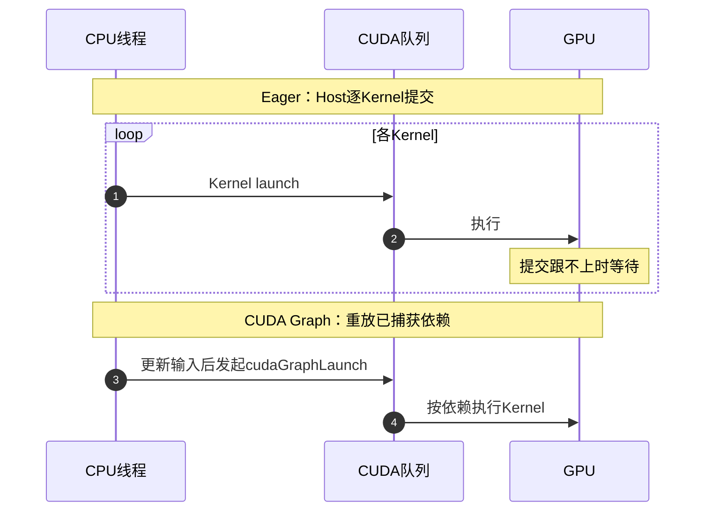

# 第11章 算子融合、预计算、编译与 CUDA Graph

融合、预计算、图编译和 CUDA Graph 分别针对不同层面的开销：算子融合减少子图内部对显存的中间读写，预计算把跨步不变的工作移出热循环，图编译自动生成并优选融合 Kernel，而 CUDA Graph 则把一整段固定拓扑的多次发射合并为单次图重放。

## 图编译与算子自动融合（torch.compile）

未融合的 Eager 实现会依次调用多个小算子并物化中间张量。不过，一个 PyTorch API 调用并不总是一次 GPU Kernel Launch：`view` 仅修改张量元数据，而单个复杂算子也可能在底层发射多个 Kernel。[PyTorch Tensor Views](https://docs.pytorch.org/docs/2.8/tensor_view.html)

### AdaLN 调制的访存开销
以 DiT 核心的自适应层归一化（AdaLN-Zero）为例：
$$\tilde{X} = \text{LayerNorm}(X) \cdot (1 + \gamma) + \beta$$
假定调制参数 `scale=1+γ` 与偏置 $\beta$ 已就绪，在未融合的 Eager 路径下，归一化、逐元素乘法和加法各自独立执行：

1. `LayerNorm` 读取输入 $X$，计算均值与方差，将标准化结果写回显存；
2. 乘法重新从显存读取标准化结果与 scale，写回乘积；
3. 加法再次读取乘积与偏置 $\beta$，写回最终调制结果。

这类逐元素与归约操作算术强度很低，耗时往往受限于显存带宽与密集的 Kernel 发射空档。

### 融合与 Graph Break
`torch.compile` 默认的 TorchInductor 后端会自动融合相邻的逐元素与归约算子，省去中间张量落盘；若进一步指定 `mode="reduce-overhead"`，编译器还会尝试用 CUDA Graph 包装无图断裂的子图以削减 Host 发射开销（与下一节显式管理静态 CUDA Graph 互补）。若代码中包含无法静态追踪的控制流，编译器会发生图断裂（graph break），在 `fullgraph=True` 下则会直接报错。排查时可开启日志：

```bash
TORCH_LOGS="graph_breaks" python inference.py
```

常见触发点包括：

1. 标量提取与数据相关 Python 控制流：如在热路径中调用 `t.item()` 或 `if t > 500:` 触发隐式设备同步；
2. 自定义算子缺失元数据推导：第三方 C++/CUDA 算子未注册 fake/meta 实现；
3. 热路径插桩：依赖 GPU 张量数值的日志、断言或 NaN 检查，应移出编译与计时区域。

## CUDA Graph 静态图捕获与显存池管理

输入输出形状与执行拓扑固定的前向子图适合用 CUDA Graph 捕获。录制单次 block 前向还是整个去噪步，取决于 scheduler 更新、条件切换和跨卡通信如何组织；本章小例先隔离测量一个固定算子栈的发射收益。

图示：Eager 逐项提交与 Graph 重放的依赖关系，横向距离没有时间含义。



### 录制前置条件与约束
捕获与 replay 需要满足三项基本约束：
1. **replay 地址与生命周期稳定**：静态输入、输出 buffer 及模型参数地址在重放期间必须保持有效。捕获区域内部的中间张量分配由 capture allocator 接管并保留在 graph 私有内存池中，`torch.empty`、`torch.zeros` 本身无需手工改写为外部预分配；
2. **捕获区域内禁止主机同步**：`.item()`、依赖 GPU 结果的 Python 分支和阻塞式 CPU 拷贝必须移出捕获范围；预热、同步计时与数值校验统一放在 graph 外部；
3. **replay 拓扑与几何匹配**：单个 graph 严格重放捕获时录下的算子序列与内存地址，动态变化的标量（如当前时间步 embedding）可通过向固定 device buffer 原地 `copy_` 来更新；不同分辨率或分支路径则需分别维护独立 graph。[Graph 实测案例](#cuda-graph固定输入权重和输出地址)

### 共享显存池（Mempool Sharing）与生命周期
* **显存成本**：每个 CUDA Graph 的私有池会在 graph 存续期间保留已分配显存。为多个 Shape 或 expert 分别捕获独立 graph 时，`reserved` 显存随之累加；
* **池复用方案**：当多个 graph 按捕获顺序严格串行重放、且前一次重放的输出张量在被下一次重放覆盖前已消费完毕时，可通过 `graph_pool_handle()` 共享同一个显存池：

```python
# 仅示意共享池接口；复用前核验重放顺序与输出生命周期
mempool = torch.cuda.graphs.graph_pool_handle()
with torch.cuda.graph(g, pool=mempool):
    output = model(static_input, static_t, static_c)
```

## 用访存账本判断融合机会

仍以 $Y=\operatorname{Norm}(X)\times\mathrm{scale}+\mathrm{bias}$ 为例，令 $X$ 含 $E$ 个元素、每元素占 $b$ bytes，忽略较小的 scale/bias 广播与均值方差统计量时，分离执行与理想融合的激活读写下界对比如下：

| 路径 | 激活读写 | 载荷下界 |
|---|---|---:|
| Norm | 读 $X$，写 $U$ | $2Eb$ |
| Multiply | 读 $U$，写 $V$ | $2Eb$ |
| Add | 读 $V$，写 $Y$ | $2Eb$ |
| 分离合计 | 三阶段分别读写 | $6Eb$ |
| 理想融合 | 读 $X$，写 $Y$ | $2Eb$ |
| 理想减少量 | 中间激活读写 | $4Eb$ |

账本给出了理想节省的中间激活流量；实际提速幅度还受 L2 cache 命中率与融合 Kernel 的寄存器压力影响。将 RoPE 融入 QK 准备、或将 bias/激活函数融入 GEMM epilogue 时，需确保融合不会迫使原本走高效库函数的 GEMM 退化为慢速自定义 Kernel。

## 只预计算真正的不变量

在多步去噪循环中，固定文本 prompt 的 encoder 输出、跨步不变的 cross-attention 条件 K/V，以及固定窗口几何下的旋转位置编码表（RoPE cos/sin），都可以提到去噪循环之外预计算一次。相反，依赖当前噪声步 $t$ 或动态相机姿态的分支则必须按步更新。

### 固定步序的 AdaLN 调制查找表

当采样时间步序列、输入条件和模型权重在单次请求内固定时，各去噪步的逐层 AdaLN 调制向量可以在进入去噪主循环前一次性批量算出，存为紧凑的查找表（LUT）。设网络共有 $L$ 层、每层包含 $M$ 组独立条件调制分支、输入条件宽度为 $D_{\mathrm{in}}$、隐藏层宽度为 $D$，每组输出 6 个调制向量（如 double block 的 shift/scale/gate），采样共 $S$ 步、每元素占 $b$ 字节，忽略 bias 时：

$$P_{\mathrm{proj}}=6LMD_{\mathrm{in}}D,\qquad
M_{\mathrm{LUT}}=6SLMD\,b$$

其中 $P_{\mathrm{proj}}$ 是调制线性层的静态参数量，$M_{\mathrm{LUT}}$ 是预计算查找表的显存载荷。由于时间步数 $S$ 远小于 $D_{\mathrm{in}}$（例如 $S \in [4, 50]$，而 $D_{\mathrm{in}}$ 通常为数千），$M_{\mathrm{LUT}}$ 往往只有数十至上百 MiB。将步序固定的调制投影合并到循环外预计算，一方面能把多步小矩阵乘合并为一次批处理并省去循环内的重复发射，另一方面在支持权重 Offload 的部署中，若后续去噪步不再直接调用调制线性层权重，还可按需释放这部分投影权重的常驻占用。

### 位置与相机变换的原地子向量操作

三维时空 RoPE（如 MM-RoPE）或相机射线旋转编码（PRoPE）常需将每个注意力 head 的通道维 $d$ 切分为多个子区间（例如仅对特定子向量施加平面正交旋转，其余维度保持不变）。朴素实现往往先沿最后一维 `split` 切片，分别计算旋转后再调用 `torch.cat` 重新拼接回 `[B, N, H, d]`。在长序列、数十层、多步去噪的累积调用下，反复 `split + cat` 不仅增加短 Kernel Launch，还会频繁触发完整 Q/K 张量大小的临时显存分配与拷贝。

将这类变换改写为基于步幅（strided view）的原地子向量操作，或者直接融入 QK 归一化与位置编码的自定义 Triton/CUDA Kernel，可以直接在原张量的目标通道切片上完成二维旋转写入，省去跨步拼接产生的中间缓冲与带宽消耗。

此外，推理阶段固定的 LoRA 分支也可以在加载时直接合并（merge）进主干权重副本，省去每次前向的额外低秩旁路计算。合并与权重量化的先后次序会影响舍入误差，上线前需在代表性提示词集上核对数值与画面一致性。

## Regional compilation 与冷启动预算

对结构完全重复的数十个 DiT Block，优先对单个标准 Block 启用区域编译（regional compilation），让编译器复用同一套生成代码，能够显著缩短首次编译的冷启动耗时。[PyTorch 官方教程](https://docs.pytorch.org/tutorials/recipes/regional_compilation.html)

设编译带来的额外初始化耗时为 $C$ 秒，编译后每次请求净节省 $d$ 秒（$d>0$），则摊平冷启动成本所需的最小请求数为 $\lceil C/d\rceil$。在多分辨率或多帧数规格并存的线上服务中，还需结合编译缓存命中率与重编译触发频率评估实际收益。

## CUDA Graph：固定输入、权重和输出地址

[合成实验](../../examples/rtx_dit_lab.py)固定 BF16 输入 `[64,512]` 与 8 组串联的 `Linear(512,512)+SiLU`（seed 43），按 eager → graph replay → eager（A1/B/A2）顺序配对运行。两臂均将结果写入同一预分配输出 buffer；重放前先把输出填满 NaN 再执行 replay，验证 Graph 确实重算了全部输出而非残留旧值。捕获与 side-stream 预热耗时单独记录，不计入热态样本。

### 单卡 RTX 5090 结果

| 计时范围 | A1 eager | B replay | A2 eager | A/B |
|---|---:|---:|---:|---:|
| 含最终同步 wall，ms/call | 0.186824 | 0.040165 | 0.189341 | 4.68268× |
| CUDA stream event span，ms/call | 0.185826 | 0.039346 | 0.188224 | 4.75330× |

wall 首尾漂移 +1.347%；B、A2 及 NaN 覆盖检查均与 A1 逐位相同，参数和输入版本未变，输出地址保持固定。CUDA allocated 峰值 22,553,600 B。这种轻量算子栈的单次 Kernel 执行极短，Eager 模式主要受 Host 发射空档限制；进入完整 DiT 后，大尺寸 GEMM 与 Attention 会拉长设备执行时间，从而摊薄一部分 Host 发射开销。

捕获与 side-stream 预热共耗时 48.1565 ms，按单次调用节省 0.147917 ms 计算，约需 $\lceil 48.1565 / 0.147917 \rceil = 326$ 次重放摊平建图成本。

### 数据中心 SM90 GPU 单卡结果

在数据中心 SM90 GPU（80 GB、CUDA runtime 13.1）上，以单张卡运行相同算子栈：

| 计时范围 | A1 eager | B replay | A2 eager | A/B |
|---|---:|---:|---:|---:|
| 含最终同步 wall，ms/call | 0.248602 | 0.045280 | 0.260822 | 5.62522× |
| CUDA stream event span，ms/call | 0.247341 | 0.044233 | 0.259149 | 5.72524× |

wall 首尾漂移 +4.915%，CUDA event 漂移 +4.774%。虽然 A2 相对 A1 存在约 4.9% 的顺序执行漂移，但候选 B 相对基线的加速比达 5.62522×（耗时缩短约 82%），效应量远大于基线漂移，结论稳健；B、A2 与 NaN 覆盖检查均逐位通过。Capture 与 side-stream 预热合计 59.6761 ms，热态每次调用平均节省 0.209432 ms，摊平建图成本约需 $\lceil 59.6761 / 0.209432 \rceil = 285$ 次调用。两组观测均为历史样本，采集所用脚本与随包脚本的差异见[附录 B](appendix-b-reproduction.md#历史观测与随包脚本版本)，完整样本见 [measurements.json](evidence/measurements.json) 与 [measurements_sm90.json](evidence/measurements_sm90.json)。

## 双向与 AR 的捕获范围

Wan2.2 包含高低噪声两份 expert，需按 expert 分别维护捕获图；去噪步的时间标量通过固定地址的 device buffer 原地更新，而外层的 expert 切换仍由 Python 调度。若开启了动态改变参数存储地址的权重 Offload，则需配合固定地址的 device staging buffer 才能与 CUDA Graph 兼容（详见第 16 章）。

SolarWM 等连续 AR 模型还涉及滑动窗口填满前后的 KV 长度变化、环形淘汰以及 raw KV 写入。实践上宜先对形状固定的单层或主干无状态子图启用 CUDA Graph，将动态窗口管理留在图外或配合支持固定槽位地址的 Paged/Ring KV 缓冲。
