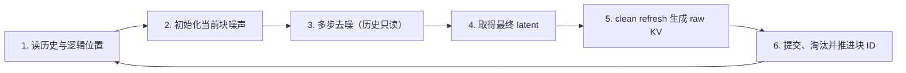
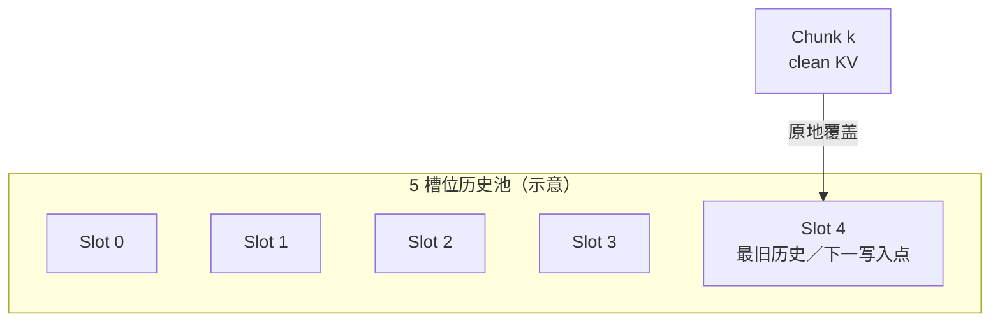

# 第12章 AR 历史 KV 与状态管理

AR 历史 KV 保存已生成上下文的执行状态。优化对象除了 tensor 本身，还包括有效窗口、逻辑位置和提交时机：任何一项变化都会进入未来 chunk 的输入。本章用公开 SolarWM 源码解释状态生命周期，用合成 CPU 小例比较 list 与 ring，并结合 50 层 AR 规模的合成微基准分析活跃窗口与分页池的容量和提取开销；基础容量公式见[第 4 章](04-memory-and-state.md)。

## 从当前块到已提交历史

[公开 SolarWM rollout](https://github.com/Junchao-cs/SolarWM/blob/c517b9d7292ab5e3a6e95a7bd2d65ef10c5326bb/src/solarwm/backends/minimax_h3/sgf_rollout.py)在当前块去噪结束后，以最终预测的 clean latent 再执行一次前向并提交 KV。去噪迭代期间只读已有历史，最后一步去噪输入仍是更新前的带噪 latent；只有紧随其后的 clean refresh 才以无噪 latent 生成可供后续块引用的历史 KV。

这里的时间坐标方向与[第 6 章](06-evaluations-and-distillation.md)相反。第 6 章取 $t=0$ 为数据端、$t=1$ 为噪声端；[SolarWM 的 flow 实现](https://github.com/Junchao-cs/SolarWM/blob/c517b9d7292ab5e3a6e95a7bd2d65ef10c5326bb/src/solarwm/backends/minimax_h3/torch_flow.py)则使用 $u=1-t$：

$$x_u=u\,x_{\mathrm{data}}+(1-u)\,\epsilon,\qquad u=1-t$$
$$v_u=x_{\mathrm{data}}-\epsilon,\qquad \widehat x_{\mathrm{data}}=x_u+(1-u)\widehat v_u$$

因此其 clean refresh 传入 `timestep` 参数 $u=1.0$（即第 6 章的 $t=0$，纯数据端）。不同代码库对 `timestep` 的正反向定义各异，对照采样日程时需先核对噪声系数的映射关系。

是否需要单独的 refresh 前向，取决于训练与推理约定的上下文协议。例如 [Causal-rCM](https://github.com/NVlabs/rcm/blob/ed3cb14dd936f92cdc9f9381af7369991509b41f/rcm/inference/wan2pt1_t2v_causal_infer.py)采用自身的 APPEND 路径。若想省去额外前向，前提是验证最后一步去噪状态与下一块训练时所见的历史分布兼容。

## 有界窗口与环形存储

固定窗口模型在填满窗口后只保留规定数量的最近历史块，KV 显存随窗口大小封顶，而非随总视频时长无限增长。有界 `list` 即可限制保留块数；环形池（ring buffer）则进一步复用预分配的固定物理槽位，避免在滚动生成中频繁分配和释放大张量。

沿用第 2、4 章记号，设窗口保留 $K$ 个历史 chunk（当前去噪块另计，代码中亦常记为 `W_history`），每层 K/V 缓冲池可组织为 `[B, K, N_chunk, H_KV, d]`。下面以 $K=5$ 槽位环形池示意覆盖写入：

生成块编号 $k$ 从 0 开始时，当前块的写入槽位为：

$$s=k\bmod K$$

若将槽位与块内 Token 轴展平，则对应连续切片 `[s*N_chunk:(s+1)*N_chunk]`，可通过 `copy_` 原地覆盖最旧槽位。当环形池发生环绕后（例如逻辑顺序对应物理槽位 `[3,4,0,1,2]`），若算子依赖时间顺序或局部相对位置，读取时仍需按逻辑块序重组或通过索引表映射，这部分准备开销应与 Attention Kernel 一并衡量。

### 逻辑位置与物理槽位分开保存

物理槽位循环复用，而数学上的时间与相机位置则随生成推进持续递增。因此状态管理器必须将**物理存储槽号**与**逻辑 chunk/帧 ID 及相机外参**分开记录。

[公开 SolarWM Attention](https://github.com/Junchao-cs/SolarWM/blob/c517b9d7292ab5e3a6e95a7bd2d65ef10c5326bb/src/solarwm/backends/minimax_h3/sgf_attention.py)在历史池中保存的是 QK Norm 之后、MM-RoPE/PRoPE 旋转之前的 **raw K** 与 V。每次前向读取时，先将当前块 query 与窗口内可见历史映射到当前窗口的局部相对位置，施加位置与相机旋转变换后送入 Attention，而池中的 raw KV 保持不变。这样当滑动窗口向前滚动时，历史块可以在新窗口坐标系下重新计算相对旋转；反之，若模型缓存的是绝对位置编码后的 post-RoPE K，则需配套相应的相对位移重标定策略。

## KV 精度、布局与量化开销

单层历史逻辑上为 `[B, N_history, H_KV, d]`，物理上可存为 chunk 列表、连续预分配池或分页池（paged cache）。若将历史 KV 压缩为 FP8，需明确量化作用在 raw K/V 还是 post-RoPE K/V 上，并计入缩放因子（scales）与对齐开销：

$$M_{\mathrm{BF16}}=2BN_{\mathrm{history}}H_{\mathrm{KV}}d\times2\ \mathrm{B}$$
$$M_{\mathrm{FP8,payload}}=2BN_{\mathrm{history}}H_{\mathrm{KV}}d\times1\ \mathrm{B}$$
$$M_{\mathrm{FP8,total}}=M_{\mathrm{FP8,payload}}+
M_{\mathrm{scales}}+M_{\mathrm{padding}}+M_{\mathrm{metadata}}$$

式中前导因子 2 对应 K 与 V 两份张量。对于缓存 raw KV 的模型，读取反量化后的误差还会经过后续的 RoPE 与相机旋转变换，并在自回归生成中逐块传递。

分页结构适合多请求并发服务中变长历史的动态拼装，能减少外部内存碎片；而在单请求、固定窗口长度的连续 AR 视频生成中，按块对齐的连续预分配池往往索引更简单、访存更连续。

## CPU 小例：两套环境中 ring 均稍慢

[合成实验](../../examples/rtx_dit_lab.py)在 CPU 上对比容量为 5 的 `list` 与 `ring` 容器：连续执行 12 次 raw K/V 的 `clone+detach` 提交、按时间序读取、滚动淘汰与末尾 `reset`。每份 K 或 V 形状为 `[1,2,8,16]`（FP32，1 KiB），读取时展平并用 `torch.cat` 拼接核对。A1/B/A2 三臂输出逐位相同，`reset` 后引用全部清空。

在 RTX 5090 宿主机上，`list` 两侧均值约 0.221478 ms/epoch，`ring` 约 0.228329 ms/epoch，A/B 为 0.969995×（`list` 快约 3.0%），首尾漂移 −0.866%。在 SM90 GPU 宿主机上，`list` 均值约 0.236858 ms，`ring` 约 0.243837 ms，A/B 为 0.971377×（`list` 快约 2.9%），首尾漂移 +0.504%。由于张量仅 1 KiB，计时主要反映 Python 列表切片与自定义类取模索引的解释器开销。完整样本见 [measurements.json](evidence/measurements.json) 与 [measurements_sm90.json](evidence/measurements_sm90.json)。该实验用于验证滑动窗口的读写顺序与引用清理契约，真实显存带宽表现需在全尺寸 GPU 张量上评估。

## AR 规模合成 KV：活跃窗口与预分配池

[AR 规模 KV 微基准](evidence/ar_microbench_sm90.json)在单张数据中心 SM90 GPU（80 GB）上评估真实视频 AR 尺寸下的历史 KV 容量与提取开销：设定 $L=50$ 层、$H_{\mathrm{KV}}=56$ 头、$d=128$、每块 $1200$ 个 token、活跃滑动窗口保留 $K=5$ 块（共 $6000$ 个活跃 token）。

> [!NOTE] 证据等级说明：历史汇总观察（待补完整逐次样本与脚本）
> 与其余四项保存了完整 warmup/hot 逐次样本和随包复现脚本的实验不同，该记录仅保存历史汇总结果（`summary_only: true`），不含逐次热样本、统计量口径（均值/中位数）、首尾漂移或独立采集脚本；随包的 `review_public_evidence.py` 可离线核验其池容量几何与耗时比例算术，但不能复核采集过程。

按第 4 章公式，5 块活跃窗口的 BF16 K/V 净载荷（同时也是三条路径每次提取并还原出的目标 BF16 张量总大小）为：

$$M_{\mathrm{active}}=2\times50\times6000\times56\times128\times2
=8{,}601{,}600{,}000\ \mathrm{B}\approx8.60\ \mathrm{GB}\ (8.01\ \mathrm{GiB})$$

当改用按页分配的 Paged Cache（页大小 $64$ token）时，单个 $1200$-token 块需要向上取整分配 $\lceil1200/64\rceil=19$ 页，即 $19\times64=1216$ 个 token 槽位（含页尾 padding 16 个槽位）。分页池静态预留 $7$ 块容量（含 5 块活跃历史与 2 块缓冲余量），总预分配槽位数为 $7\times1216=8512$，对应 50 层 BF16 K/V 池常驻载荷 $12{,}202{,}803{,}200\ \mathrm{B}$（约 $12.20\ \mathrm{GB}$ / $11.36\ \mathrm{GiB}$）。将该分页池存为单字节 FP8 E4M3 时，K/V 池常驻载荷严格减半为 $6{,}101{,}401{,}600\ \mathrm{B}$（约 $6.10\ \mathrm{GB}$ / $5.68\ \mathrm{GiB}$），另加每页每头 1 个 FP32 scale（$2\times50\times7\times19\times56\times4=2{,}979{,}200\ \mathrm{B}$），合计 $6{,}104{,}380{,}800\ \mathrm{B}$。

下表将**池常驻载荷**与**每次 Gather 实际输出的连续 BF16 载荷**分开列出（十进制 $1\ \mathrm{GB}=10^9\ \mathrm{B}$）：

| 路径 | 50 层 Gather 汇总耗时（ms） | Gather 输出 BF16（GB） | 池常驻 K/V 载荷（GB） |
|---|---:|---:|---:|
| Chunk List | 6.63 | 8.60 | 8.60（8.01 GiB） |
| Paged BF16 | 21.50 | 8.60 | 12.20（11.36 GiB） |
| Paged FP8 E4M3 | 64.21 | 8.60 | 6.10（5.68 GiB） |

三条路径的实现与容量口径：Chunk List 对 5 块活跃历史的连续张量直接执行 `torch.cat`（6,000 个活跃 token）；Paged BF16 使用 7 块预分配池（8,512 个槽位，含页尾 padding），在 Python 侧按页表逐页收集并还原为连续 BF16；Paged FP8 E4M3 使用同一 8,512 槽位池的 FP8 表示（另加 2.98 MB scales），在 Python 侧逐页收集并反量化为连续 BF16。

阅读上表时需注意两条分页路径的计时范围（`latency_scope`）：
* **Python 侧逐页物化开销 vs 分页机制本身**：表中的 `21.50 ms` 与 `64.21 ms` 测量的是**在 Python 侧按页表逐页索引收集（并从 FP8 反量化）物化出 8.60 GB 连续 BF16 张量**的耗时，而非融合 PagedAttention Kernel 的算子内部耗时。如果为了对接只接受连续 BF16 输入的步骤（如在 Attention 外先对全量历史 raw KV 做位置/相机旋转）而在每次前向执行 Python 侧逐页物化，这部分收集与反量化开销就会成为显著瓶颈。
* **算子选型建议**：优先评估能够直接按页表读取、在线反量化或融合位置/相机变换的实现，并验证完整路径的容量与延迟。上表没有比较向量化 Gather、独立融合 Gather/反量化等替代方案，不能据此认定只有融合 PagedAttention 才能获益。在单请求固定窗口场景下，若仍需在 Attention 外对历史 K 做逐块重标定，按块连续存放的 Ring/Chunk Pool 也是避免 Python 逐页收集的候选；仍需计入后续拼接、重标定与物化成本。

## 状态变更的验证顺序

修改历史 KV 结构或精度时，依次在填窗前、刚填满窗口、首次触发淘汰和多次环绕四个节点核对每层 K/V、逻辑块序、有效长度及下一块输入；同时穿插请求 `reset` 与条件切换，确认旧张量未被容器或异步流残留引用。完成单步对齐后，再运行跨多次窗口淘汰的长序列生成，按[第 5 章](05-measurement.md)检验长程时序稳定性与画面质量。
