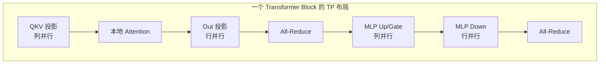
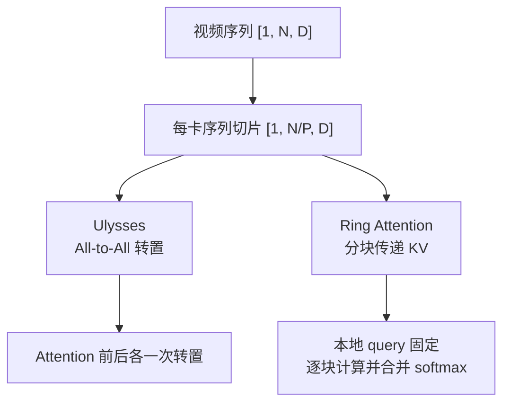

# 第14章 多 GPU 并行与通信

多 GPU 并行切分服务于三个不同目标：缩短单请求延迟、容纳单卡放不下的模型与激活、提升多请求并发吞吐。不同目标对应的切分维度与通信模式各异。本章基于公开实现推导张量并行（TP）、序列并行（SP）与分层放置的理论通信量；实际部署时需将集合通信、布局转换和流同步等待放在同一时间线上核验。

## 张量并行的层内通信

标准 Megatron 风格的 TP 在 Transformer Block 内交替使用列并行（Column Parallel）和行并行（Row Parallel）：QKV 投影按列切分，各 rank 独立计算本地注意力头；输出投影按行切分，再通过 All-Reduce 合并各 rank 对残差分支的贡献；MLP 的升维与降维同样按列、行配对切分。

在该布局下，每个 Block 单次前向包含两次逻辑 All-Reduce。若模型有 50 层、单次请求执行 40 次主干前向，则会触发 $2\times50\times40=4000$ 次集合通信。即便每次传输的张量不大，数千次高频通信的启动延迟与同步屏障也会直接进入关键路径，因此 TP 通常依赖高带宽、低延迟的片间互联（如 NVLink）。

### 先确认 P2P，再估计链路预算

PCIe 标称线速与显存带宽只代表硬件上限，跨卡通信预算必须基于目标消息大小下的实测有效带宽。以 GeForce RTX 5090 等消费级显卡为例，[NVIDIA 在 2025 年 3 月的公开说明](https://forums.developer.nvidia.com/t/p2p-issue-using-two-rtx-5090-gpus/326776/8)明确其官方支持范围不包含跨卡 GPU P2P 直传；在此类拓扑上规划多卡并行，必须将经由 Host 内存转发（Host staging）的开销纳入考量。

上机测试前，先记录 GPU 与驱动版本，执行 `nvidia-smi topo -m`、`nvidia-smi topo -p2p r` 与 `nvidia-smi topo -p2p w`，并用 `torch.cuda.can_device_access_peer` 逐对核实 P2P 可用性；随后在真实消息尺寸下运行 NCCL 基准并观察 profiler 中实际选中的传输通道。[CUDA Peer Access 文档](https://docs.nvidia.com/cuda/archive/12.8.1/cuda-c-programming-guide/index.html#peer-to-peer-memory-access)给出了底层能力查询与启用规范。

## 序列并行：切序列还是切 head

当视频 Token 序列很长而 batch 较小时，序列并行（SP）将序列维度切分到 $P$ 张卡上协同计算。纯 SP 通常在每张卡保留完整权重副本，显存收益主要来自将长序列激活与中间张量均摊到各 rank。

### Ulysses 的两次转置

[DeepSpeed Ulysses](https://arxiv.org/abs/2309.14509)在 QKV 线性投影和 MLP 阶段让各卡独立处理本地的 $N/P$ 序列切片，进入 Attention Core 时切换为按注意力头（head）分工。设标准 MHA 的头数满足 $H\bmod P=0$（若为 GQA 则需按 KV 头数重算切分或复制策略）：

1. **第一次 All-to-All**：将 `[N/P, H, d]`（切序列、全 head）转置为 `[N, H/P, d]`（全序列、切 head），Q、K、V 一并跨卡重排；
2. **本地 Attention**：每张卡对分到的 $H/P$ 个 head 计算完整序列长度 $N$ 的注意力；
3. **第二次 All-to-All**：将输出从 `[N, H/P, d]` 转回 `[N/P, H, d]`，交由后续输出投影和 MLP 继续按序列切片处理。

设并行度为 $P>1$、序列长度为 $N$、隐藏维度为 $D$、每元素占 $b$ 字节，均匀切分下每张卡的 Attention Core 计算量与跨卡发送载荷为：

$$F_{\mathrm{core,rank}}\approx\frac{4N^2D}{P},\qquad
M_{\mathrm{send,rank}}\approx\frac{(3+1)NDb(P-1)}{P^2}$$
$$\frac{F_{\mathrm{core,rank}}}{M_{\mathrm{send,rank}}}
\approx\frac{NP}{(P-1)b}$$

固定卡数 $P$ 时，稠密 Attention 的计算量随 $N^2$ 增长，而 All-to-All 通信量仅随 $N$ 线性增长，因此序列越长，计算越容易掩盖或摊薄通信占比。反之，当序列较短或卡数 $P$ 很大时，高频 All-to-All 的启动开销与转置重排就会凸显。

### Ring Attention 的分块交换

[Ring Attention](https://arxiv.org/html/2310.01889v4#S3)让每张卡始终持有本地的 $N/P$ 个 query，同时将各卡的 K/V 切片沿逻辑环逐跳传递。每一跳计算当前本地 query 对收到 K/V 分片的局部注意力，并按[第 8 章](08-attention-kernels.md)的 online softmax 递推公式更新全局最大值与归一化分母。

工程实现上常借助 `dist.P2POp` 与 `dist.batch_isend_irecv` 在后台通信流上异步收发下一跳的 K/V 分片，同时在计算流上执行当前分片的 Attention。要实现理想的计算-通信重叠，单跳计算耗时（约 $4(N/P)^2D$ FLOPs）必须足以覆盖单跳 K/V 传输耗时（$2(N/P)Db$ 字节）；在经由 Host 内存转发或带宽受限的链路中，分片过细反而会放大每次收发的调度延迟。[PyTorch 2.8 通信 API](https://docs.pytorch.org/docs/2.8/distributed.html#torch.distributed.P2POp)

### xDiT/USP：在两个并行维度之间选组合

[USP（Unified Sequence Parallelism）](https://github.com/feifeibear/long-context-attention/blob/a5f8f600d435ced180a97c91c68e87ff3cfb8f89/README.md)将 Ulysses 的按头切分与 Ring 的分块环传组合成二维网格：Ulysses 维度受限于注意力头数（如节点内走高带宽 NVLink 做 All-to-All），Ring 维度继续扩展并行卡数（如跨节点或跨组传递 K/V）。[xDiT](https://github.com/xdit-project/xDiT/blob/bf7a205658c55903a3d8c4146cafc2253a4f1757/README.md)在此基础上集成了面向扩散主干的混合并行管线。选型时需结合模型真实 KV 头数、序列长度和机器互联拓扑扫描 (Ulysses, Ring) 组合，并计入转置 reshape、padding 及非并行模块的完整耗时。

## Host 中转时，优先减少通信频率

当硬件不支持 GPU P2P 直传、通信退化为 Host staging 时，每次跨卡传输都需经过两段 PCIe 链路与主存缓冲：

$$\text{GPU 0}\xrightarrow{\text{PCIe}}\text{Host memory}\xrightarrow{\text{PCIe}}\text{GPU 1}$$

在这样的拓扑上，每层触发数次 All-Reduce（TP）或 All-to-All（SP）很容易让 PCIe 与 CPU 内存控制器成为瓶颈，导致多卡比单卡更慢。若首要目标是解决单卡显存容量不足，采用**粗粒度按层放置（Pipeline / Layer Placement）**——例如将前一半 Block 放在 GPU 0、后一半放在 GPU 1，仅在层间交界处传递一次残差激活——能将每步主干前向的跨卡通信从上百次压缩到一两次。

## CFG、权重切分与 DP

对于包含正负双分支的 CFG 去噪，CFG Parallel 将 conditional 与 unconditional 分支分配给不同 GPU 并行执行，每步只需交换一次预测结果即可将单卡分支计算负载减半，理想情况下使分支计算阶段的关键路径接近减半；总计算量并未减少，实际收益还需计入通信同步、分支负载差异以及拆掉单卡双分支合批（`2B`）后的算子利用率变化。当单卡可驻留权重且互联开销可控时，它常是 2 卡配置的优先候选；若模型已做单分支 CFG 蒸馏，则优先转向 SP 或数据并行（DP）。

当单卡放不下模型权重时，FSDP 风格的权重分片在每层前向时按需 All-Gather 权重，以通信换容量；而离线批量生成或多并发服务则可通过 DP 在各卡独立跑不同请求，获得近似线性的聚合吞吐扩展。

## 双向视频与 AR-chunk 的选择顺序

Wan2.2 的全序列双向生成序列长、包含双分支 CFG，适合优先评估 CFG Parallel 与 Ulysses/Ring SP（参考 [SGLang Diffusion 并行对比](https://docs.sglang.io/docs/sglang-diffusion/ring_sp_performance)）。而连续 AR-chunk 单次前向的当前块 query 相对全序列较短（常在千余至数千 token）、历史 KV 较长，单块计算量显著小于全序列扩散；优化决策应先评估单卡全量驻留与局部算子加速，避免把本可留在显存的活跃 KV 无故搬往 Host 引入额外传输开销。仅当单卡显存不足且确需外移历史时，再评估持久锁页 KV 卸载与异步预取；确实需要多卡扩展时，再结合互联带宽与 query/KV 长度比较低开销的 Ulysses 小度数切分或粗粒度分层放置，避免高频层内通信无法被短 query 计算摊平。
