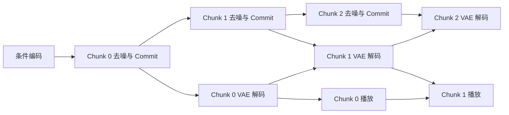

# 第15章 VAE、流式执行与端到端交付

从 latent 到客户端可播放画面，还需经过 VAE 解码、重叠区融合、音视频混流编码与网络传输。当 DiT 主干通过少步蒸馏、缓存与低精度算子大幅提速后，外围解码与交付链路往往上升为新的端到端瓶颈。

## 主干加速后的耗时分布

仅当各阶段严格串行执行且无跨阶段重叠时，单次请求的端到端延迟可写为线性累加（其中 $N_{\text{call}}$ 为包含上下文 refresh 在内的实际主干调用次数）：
$$T_{\text{E2E}} = T_{\text{TextEnc}} + \sum_{s=1}^{N_{\text{call}}} T_{\text{DiT}}(s) + T_{\text{VideoVAE}} + T_{\text{AudioVAE}} + T_{\text{Mux/IO}}$$

下表给出一个串行算术示例：当 DiT 主干耗时从 17.50 秒压至 1.10 秒而其余模块不变时，各阶段占比发生显著转移：

| 模块 | 假设基准耗时 | 耗时占比 | 假设仅优化 DiT 后耗时 | 耗时占比 |
|---|---|---|---|---|
| **文本与条件编码** | 0.50 s | 2.5% | 0.50 s | 13.9% |
| **DiT 主干去噪循环** | 17.50 s | **87.5%** | 1.10 s | 30.6% |
| **3D-VideoVAE 像素解码** | 1.70 s | 8.5% | 1.70 s | **47.2%** |
| **AudioVAE 音频解码** | 0.08 s | 0.4% | 0.08 s | 2.2% |
| **媒体混流与编码写盘** | 0.22 s | 1.1% | 0.22 s | 6.1% |
| **端到端总时间 $T_{\text{E2E}}$** | **20.00 s** | 100% | **3.60 s** | 100% |

按 Amdahl 定律，若外围阶段完全不改动且保持串行，整条管线的理论加速上限受限于非 DiT 耗时之和：
$$S_{\max} = \frac{20.00}{0.50 + 1.70 + 0.08 + 0.22} = 8.0 \times$$
要突破这一串行上限，一方面需要直接优化 3D-VAE 解码本身，另一方面则在连续 AR-chunk 场景下将“当前块去噪”与“上一块解码/交付”流水化重叠。

## VAE：先区分容量优化和计算优化

3D 视频 VAE Decoder 包含大量高分辨率时空卷积与上采样层，特征图在空间和时间展开后往往比 DiT 主干占用更多瞬态显存。优化 VAE 时需先分清目标是压低显存峰值（防 OOM）还是缩短解码耗时。

### Tiling 降低峰值，也会重复工作

空间分块解码（Spatial Tiling）将 latent 切分为带重叠边界（overlap）的局部瓦片逐块解码，从而大幅降低单次卷积激活的显存峰值。但重叠区域会被相邻 tile 重复计算；粗略按二维覆盖面积衡量，总解码面积相对整幅画面的倍数（覆盖面积比）为：

$$r_{\mathrm{area}}\approx
\frac{n_{\mathrm{tile}}h_{\mathrm{tile}}w_{\mathrm{tile}}}{A_{\mathrm{full}}}\ge 1$$

其中 $n_{\mathrm{tile}}$ 为瓦片数，$h_{\mathrm{tile}},w_{\mathrm{tile}}$ 为单瓦片尺寸，$A_{\mathrm{full}}$ 为完整画面面积；因重叠而多出来的**重复计算比例**（冗余面积占比）则为 $r_{\mathrm{area}}-1$。瓦片切得越碎，重叠区重复计算和 Kernel Launch 越多，解码总延迟通常越长。因此实践中应在显存预算允许的范围内尽量选用较大的 tile 尺寸。

为消除瓦片拼接处的亮度和纹理接缝，重叠区通常采用余弦窗（Hanning window）或线性渐变加权融合。设 $x\in[0,\delta]$ 为重叠区内的相对坐标，平滑过渡权重可取：

$$w(x)=\frac{1}{2}\left[1-\cos\left(\frac{\pi x}{\delta}\right)\right]$$

所有覆盖同一像素位置的瓦片输出按权重归一化相加。空间加权能消除静态接缝，但如果时序维度缺乏上下文，画面仍会出现跨帧闪烁。

### 时间状态跟着 codec，而不是生成块大小

视频 VAE 的时序下采样/上采样层可能是因果卷积（依赖历史帧特征缓存）或非因果卷积（需要前后帧 lookahead）。在按 chunk 流式解码时，不能把每个生成 chunk 当作孤立短视频直接调一次无状态 `decode()`——那样会在每个 chunk 边界丢失前一帧的时序卷积状态，导致周期性跳帧或闪烁。

例如 [Diffusers v0.35.1 的 Wan VAE](https://github.com/huggingface/diffusers/blob/v0.35.1/src/diffusers/models/autoencoders/autoencoder_kl_wan.py)在时序卷积内部维护了跨步 `feat_cache`，流式调用时必须沿用 codec 原生的缓存传递与末尾冲刷（flush）协议。

### 轻量 decoder 改变质量预算

[TAEHV](https://github.com/madebyollin/taehv/blob/011dfc2112197741c540e0bdd5b7b67bcc930771/README.md) 等轻量级近似自编码器通过大幅缩减通道与层数来换取数倍解码提速与更低显存占用，并针对不同模型的 latent 空间提供专用权重。由于轻量网络属于有损近似，适合交互式实时预览或低延迟草稿生成；最终高清成片导出则可切回原版 VAE。

## 生成与解码怎样重叠

在连续 AR-chunk 生成中，当 Chunk $k$ 完成去噪与 clean KV 提交后，其 latent 即可移交 VAE 解码，同时主干继续生成 Chunk $k+1$。下图示意三阶段依赖关系（阶段起止时间见示例表）：

| 假设阶段 | 开始（秒） | 结束（秒） | 依赖与边界 |
|---|---:|---:|---|
| 条件编码 | 0.0 | 0.5 | 请求起点起算 |
| Chunk 0 去噪与 Commit | 0.5 | 1.7 | 条件编码完成 |
| Chunk 1 去噪与 Commit | 1.7 | 2.9 | Chunk 0 提交完成 |
| Chunk 2 去噪与 Commit | 2.9 | 4.1 | Chunk 1 提交完成 |
| Chunk 0 VAE 解码 | 1.7 | 2.9 | Chunk 0 提交完成 |
| Chunk 1 VAE 解码 | 2.9 | 4.1 | Chunk 1 提交、前次解码完成 |
| Chunk 2 VAE 解码 | 4.1 | 5.3 | Chunk 2 提交、前次解码完成 |
| 首块可用（里程碑） | 2.9 | 2.9 | Chunk 0 解码完成，尚未计网络与呈现 |
| Chunk 0 播放 | 2.9 | 4.1 | 假设送达即可播放，播放时长也仅为示例 |
| Chunk 1 播放 | 4.1 | 5.3 | 假设下一块已送达且前一块播放完成 |

### 首帧与稳态指标

1. **首帧呈现延迟（TTFF）与服务端首块就绪时间**：
   若以客户端实际呈现首帧为终点，端到端指标应按时间边界定义为：
   $$\text{TTFF} = t_{\text{客户端首帧呈现}} - t_{\text{约定的请求起点}}$$
   完整关键路径除模型生成外，还可能包含媒体编码/封装、网络传输、客户端解码与播放缓冲等待。若仅统计串行路径上**服务端首块就绪时间**（不含编码封装与网络/客户端阶段），可写作：
   $$T_{\text{first-chunk,server}} = T_{\text{TextEnc}} + T_{\text{DiT}}(\text{Chunk 0}) + T_{\text{VAE}}(\text{Chunk 0})$$
   报告中应与[第 5 章](05-measurement.md#计时边界)保持一致，明确 $T_{\text{DiT}}(\text{Chunk 0})$ 是否包含必要的历史 KV commit（clean latent 在末步去噪结束时即已就绪，具体实现可选择在 commit 完成后或与 commit 并行启动首块解码）。无论采用哪种口径，首块生成与首块解码之间都存在严格的数据依赖，流水线重叠无法缩短首块本身的 `DiT(Chunk 0) + VAE(Chunk 0)` 串行路径；要压低 TTFF，必须靠首块少步求值、预计算条件或更快的解码。
2. **稳态播放预算（Steady-State Pacing）**：
   设每个 Chunk 解码后可播放的视频时长为 $\Delta T_{\text{play}}$。当主干去噪与上一块 VAE 解码分布在不同设备或能充分并行重叠时，不发生播放卡顿（underrun）的稳态预算为：
   $$\max\left( T_{\text{DiT}}(\text{Chunk } k), T_{\text{VAE}}(\text{Chunk } k) \right) \le \Delta T_{\text{play}}$$
   以上表排程为例，每块可播放时长 $\Delta T_{\text{play}}=1.2\text{ s}$（例如单块产出 36 帧、按 30 fps 播放），此时 $T_{\text{DiT}}=T_{\text{VAE}}=1.2\text{ s}$ 恰好踩在不卡顿边界上；反之，若某个模型配置每块仅产出 16 帧、按 24 fps 播放（$\Delta T_{\text{play}}\approx 0.67\text{ s}$），则 $1.2\text{ s}$ 的单块生成或解码耗时就会违反上式并触发播放欠载。
   反之，若 DiT 与 VAE 共用同一张已跑满算力/带宽的 GPU，简单把它们放进两个 CUDA Stream 往往只会触发硬件资源争抢，无法真正掩盖解码耗时。因此验证双缓冲流水线时，必须先分别测出单块 $T_{\text{DiT}}$ 与 $T_{\text{VAE}}$ 的独立耗时，再对比串行与双流在完整多块序列上的总 wall time 及 trace 重叠区间。

## 联合音视频的时间轴

对于同时产出视频与伴生音轨的多模态生成任务，需将两路 codec 解码纳入同一播放时钟（PTS，Presentation Timestamp）对齐管理。[RTP 时间戳与跨流同步规范](https://www.rfc-editor.org/rfc/rfc3550#section-5.1)

* 设视频帧率为 $\text{FPS}$，音频采样率为 $R_{\text{audio}}$（如 32,000 Hz）；
* 每帧视频对应的平均音频采样点数为：
  $$S_{\text{audio/frame}} = \frac{R_{\text{audio}}}{\text{FPS}}$$
  当 $R_{\text{audio}} = 32{,}000,\ \text{FPS} = 24$ 时，$S_{\text{audio/frame}} = 1333.\dot{3}$。由于单帧采样点数不是整数，工程上应使用有理数时间基（timebase）或分数累加器计算每个 Chunk 的 PTS，避免按帧向下取整截断为 1333 个样本而导致长视频音画逐渐脱节。

### 时钟、队列与取消

流式服务在生成端与客户端之间维护有界发送队列。当客户端网络阻塞或消费变慢时，背压（backpressure）应限制在当前会话自己的流控状态内，避免阻塞全局事件循环（详见[Omni 配套文档](../omni/inference-frameworks.md)）。收到客户端打断或取消请求时，服务端立即停止调度该会话的后续 chunk，过滤已在途的旧 epoch 输出，并等待已发射的 GPU Kernel 和 DMA 传输到达完成事件后再安全回收缓冲区。

## 双向整段与 AR 逐块交付

Wan2.2 原生 T2V 入口在全部去噪步结束后才一次性调用 VAE。而 SolarWM 等连续 AR 模型天然支持逐块产出 latent，只需按 codec 的时序上下文要求对齐生成块与解码块的帧索引（并在末尾冲刷残余帧），即可构建边生成、边解码、边推流的端到端管线。
