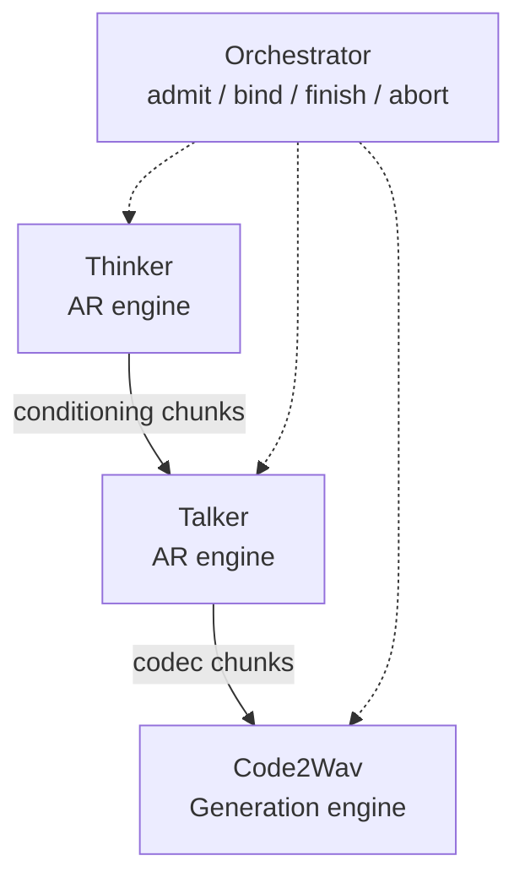

# Omni 与推理框架：阶段调度、传输和流式交付

DiT Kernel、AR 历史与流式交付进入多阶段系统后，还要处理请求调度、阶段间数据与资源回收。这里沿请求和 Chunk 追踪 vLLM-Omni 与 SGLang-Omni 的调度和数据流，分析依据为下文链接的固定版本源码；部署评测范围列在文末。

PDF 中流程图按 300 DPI 整图嵌入。Zotero“阅读模式”仍可能遗漏行内公式；核对公式时请使用普通 PDF 页面视图或离线 HTML。

## Omni × DiT：声学生成的求解与交付

语音管线中，AR 语义 Token 生成器、连续声学特征生成器与 Vocoder 可以是三个不同组件，框架中的“Talker”名称并不规定其算法。F5-TTS 明确使用 DiT 估计 Flow Matching 的速度场；CosyVoice 2 则将 AR speech token 与条件 Flow Matching 声学解码串联，所核对配置的 estimator 为 `CausalConditionalDecoder`，各代模型的声学网络应按具体配置区分。ChatTTS 的 GPT 生成 codes/hidden states，再经 decoder 或 DVAE 得到声学特征并送入 Vocos，没有这条迭代 Flow Matching 路径。[F5-TTS 主干](https://github.com/SWivid/F5-TTS/blob/45868abaabd74aabf03cd673d6dd00cc9d9c01ae/src/f5_tts/model/backbones/dit.py)、[CosyVoice 2 配置](https://github.com/QwenAudio/CosyVoice/blob/074ca6dc9e80a2f424f1f74b48bdd7d3fea531cc/examples/libritts/cosyvoice2/conf/cosyvoice2.yaml)、[ChatTTS 执行入口](https://github.com/2noise/ChatTTS/blob/77b89ee281cd479f5b1a787ada330dc975ca1f2a/ChatTTS/core.py)

与视频 DiT 直接相连的是连续特征上的速度场求解。设目标 Mel 特征为 $x_{\mathrm{data}}\in\mathbb R^{B\times T_a\times F}$，其中 $T_a$ 为声学帧数、$F$ 为频率通道；$x_{\mathrm{noise}}$ 为同 Shape 的噪声，$c$ 包含文本、speaker 及参考音频等条件。这里用 $u=0$ 表示噪声端、$u=1$ 表示数据端，与[第 6 章](../manuscript/06-evaluations-and-distillation.md)的时间变量满足 $u=1-t$。对直线路径这一特例，训练与采样可写为：

$$x_u=(1-u)x_{\mathrm{noise}}+u x_{\mathrm{data}},\qquad v_*=x_{\mathrm{data}}-x_{\mathrm{noise}}$$
$$\mathcal L=\mathbb E\left[\|v_\theta(x_u,u,c)-v_*\|_2^2\right],\qquad \frac{dx_u}{du}=v_\theta(x_u,u,c)$$
$$x_{u_{k+1}}=x_{u_k}+(u_{k+1}-u_k)v_\theta(x_{u_k},u_k,c)\quad\text{（Euler）}$$

改写为第 6 章的时间方向时，有 $\mathrm dx/\mathrm dt=-\mathrm dx/\mathrm du$，速度符号也随之反转。上式用于说明直线路径；具体模型还可能保留非零噪声下限，或采用不同的条件与路径。“一维”指 Token 沿时间轴组织，连续状态仍有 $T_aF$ 个维度。视频 latent 展为时空 Token，声学特征展为时间 Token；二者都在每次求值时刷新当前连续状态，因此每步需要重算其 Q/K/V。精确复用应从输入和计算均不变的条件分支入手。

[第 6 章](../manuscript/06-evaluations-and-distillation.md)的步数、NFE 和 CFG 区分在这里仍适用。固定 F5-TTS 源码的 `CFM.sample` 默认 `steps=32`，默认 ODE 方法为 Euler，并提供 EPSS/Sway 时间网格；固定 CosyVoice 声学入口使用 `n_timesteps=10`，求解器实现为 Euler。尝试更少步数或蒸馏时，以 checkpoint 的采样配置为起点，验证发音、韵律、speaker 相似度及 Chunk 接缝；换成显式 Midpoint 时，每个区间通常需两次速度场求值。CFG 分支即使打包在一次 forward 内，也增加有效 batch 与计算量。[F5-TTS 求解入口](https://github.com/SWivid/F5-TTS/blob/45868abaabd74aabf03cd673d6dd00cc9d9c01ae/src/f5_tts/model/cfm.py)、[CosyVoice 声学入口](https://github.com/QwenAudio/CosyVoice/blob/074ca6dc9e80a2f424f1f74b48bdd7d3fea531cc/cosyvoice/flow/flow.py)、[Euler 与 CFG 实现](https://github.com/QwenAudio/CosyVoice/blob/074ca6dc9e80a2f424f1f74b48bdd7d3fea531cc/cosyvoice/flow/flow_matching.py)

流式执行还要求模型支持相应的可见范围与状态。CosyVoice 2 的 chunk-aware 声学路径与 F5-TTS 默认全段生成采用不同的状态协议；把长文本切成短句调用，也不等于获得了模型原生的增量声学状态。只有下游所需条件和 lookahead 就绪，才可启动该 Chunk；再按[第 15 章](../manuscript/15-decoding-and-streaming.md)把声学生成、Vocoder 和传输放到可重叠的阶段。

若 TTFA 定义为服务端收到请求到客户端取得首份可播放音频，关键路径包括首段条件就绪、阶段排队、首段 ODE、Vocoder、传输和播放缓冲；若从用户说话结束计时，还要纳入端点检测和输入处理。减少 ODE 求值只缩短其中一项。`TTFA < 200 ms` 是特定负载与部署下的交互目标，应同时给出起止事件、首包音频时长、P50/P95、后续 Chunk 间隔和播放欠载。RTF 衡量持续生成是否跟得上播放，首包延迟需要单独统计。

少步方案对应第 6 章，低精度 Linear 对应第 10 章，固定 Shape 的执行与阶段重叠对应第 11、15 章。迁移 TeaCache 或 FP8 时，需要按声学激活分布重新标定阈值和量化粒度，并用音质与连续播放结果选择配置。短 Chunk 的计算量较小，额外量化、launch 与 IPC 可能抵消节省的计算时间。

## vLLM-Omni：阶段执行与跨阶段数据平面

vLLM-Omni 把一个生成请求拆成具有独立执行策略的 stage。AR stage 沿用 vLLM 的 prefill/decode、Continuous Batching 与 KV 管理；Generation stage 处理非 AR 生成组件；Diffusion stage 承载迭代去噪。拆分解决的是各阶段的排队、batch 和资源配置问题，单个 DiT forward 是否更快仍取决于其模型实现和算子后端。[架构说明](https://github.com/vllm-project/vllm-omni/blob/7266b8bd2f0058645aaa44d53de108e7cc66c999/docs/design/architecture_overview.md)

[2 月论文 v1](https://arxiv.org/abs/2602.02204v1)提出 Fully Disaggregated Serving；[10 月报告 v1](https://arxiv.org/abs/2610.09307v1)扩展 engine、replica 与会话管理。下面按固定源码解释执行路径，论文倍率按原实验条件阅读。

### 阶段图、replica 与模型并行分开配置

`PipelineConfig` 描述有哪些 stage、采用哪类执行策略及其依赖；`DeployConfig` 描述设备、replica 和 connector。逻辑上分开的 stage 可以共置，不要求每个 stage 独占一张 GPU。一个 stage 内部的 TP 与增加整个 stage 的 replica 也不同：前者让多个 rank 完成同一次计算，后者增加可服务的请求容量。

`Orchestrator` 持有跨阶段请求状态，处理提交、阶段转移、结束和取消；stage 内的 scheduler 决定本地哪个请求进入下一次执行。每个逻辑 stage 对应 `StagePool`，负责其 replica 选择与请求亲和性。同一请求的后续调用保持在已绑定的 replica 上，避免在没有状态迁移协议时把续接 Chunk 送到另一份 KV 或 decoder 状态。分布式模式可接入负载均衡，固定版本的本地选择路径采用 round robin。[StagePool 实现](https://github.com/vllm-project/vllm-omni/blob/7266b8bd2f0058645aaa44d53de108e7cc66c999/vllm_omni/engine/stage_pool.py)

以下以三阶段语音管线说明两类路径，虚线表示生命周期控制，实线表示阶段数据。图中 stage 可以各有多个 replica；图没有规定物理放置。

独立调度的收益来自允许不同阶段采用不同 batch 预算和执行节奏。例如，AR 阶段可以合并多个请求的一步 decode，非 AR decoder 可以按已就绪的 codec Chunk 组 batch。不过，若两者共用一张已饱和的 GPU，阶段拆分仍会竞争算力和带宽；若增加 replica，权重和运行时状态也会占用额外显存。是否改善首包或吞吐，需要连同 IPC 和排队一起测量。

### 沿一个 async_chunk 追踪执行

完整结果交接要求上游结束后下游才能启动；`async_chunk` 允许适配器按模型约定逐批发布中间结果。它不规定所有边都逐 Token 发送：语义条件可以随 AR decode 产生，codec 端还可以积累多个 code frame 再交给波形 decoder。prefill 输入、单步 decode 输出与 codec Chunk 具有不同 Shape，不能用同一个“Chunk 大小”概括。[async_chunk 设计](https://github.com/vllm-project/vllm-omni/blob/7266b8bd2f0058645aaa44d53de108e7cc66c999/docs/design/feature/async_chunk.md)

请求进入后，`Orchestrator._prewarm_async_chunk_stages` 提前提交接收 Chunk 的下游 stage。AR 接收端的 placeholder 先停在 `WAITING_FOR_CHUNK`，等首个有效 Chunk 到达后再进入计算。生产端完成一次可发布输出后，`OmniChunkTransferAdapter` 在 save 路径调用模型专属 processor，形成 payload 并写入 connector；接收端的后台 load 路径取得数据，再让 scheduler 把就绪请求恢复到可执行队列。大 payload 由数据平面交接，Orchestrator 继续负责请求关联和生命周期，不必把每份中间 tensor 搬回自身进程再转发。[Orchestrator 实现](https://github.com/vllm-project/vllm-omni/blob/7266b8bd2f0058645aaa44d53de108e7cc66c999/vllm_omni/engine/orchestrator.py)、[Chunk adapter 实现](https://github.com/vllm-project/vllm-omni/blob/7266b8bd2f0058645aaa44d53de108e7cc66c999/vllm_omni/distributed/omni_connectors/transfer_adapter/chunk_transfer_adapter.py)

这里的调度单位也有正确性约束。固定版本的 Generation scheduler 将 connector 交付的一个 Chunk 作为不可分的单位：剩余 token 预算不够时完整推迟，不能任意切开 codes 与其长度、结束标记。Chunk 若大于整个 step 预算，会进入错误与清理路径；保留队列顺序的推迟也可能降低混合 Chunk 大小时的利用率。因此，减小 Chunk 会增加消息和调度次数，增大 Chunk 又会增加积累等待并影响 admission。选择应同时查看首次可消费输入、每 Chunk 排队和持续生成间隔，流式关键路径的计时方法见[第 15 章](../manuscript/15-decoding-and-streaming.md)。

### Connector 搬什么，何时才算搬完

上游 `OmniConnector` 设计文件仍将以下规则标为**Candidate invariants**，属于设计约束，不能据此推断所有后端、错误路径都已满足。[固定设计文件](https://github.com/vllm-project/vllm-omni/blob/7266b8bd2f0058645aaa44d53de108e7cc66c999/docs/design/module/omni_connector.md)

| 约束 | 对实现的要求 |
|---|---|
| `CONNECTOR-INV-001` | connector 负责传输，不选择下一个逻辑 stage 或执行模型策略；路由仍由管线与控制层决定。 |
| `CONNECTOR-INV-002` | 两端对数据身份、Shape、dtype、placement、ownership 和 completion 语义一致。接收端等到数据就绪才能读取，生产端等到消费或传输完成才能复用源 buffer。 |
| `CONNECTOR-INV-003` | 正常结束、取消、失败和 shutdown 都有确定的资源清理责任，覆盖 buffer、handle、连接及后台任务。 |

隐藏状态、codec codes、DiT latent 与 attention KV 是不同数据。即使都表示为 tensor，接收端仍需知道层/位置或 Chunk 序号、有效长度及模型状态语义。传输了 Thinker 的隐藏状态，不表示复用了 Thinker 的 KV；能传 KV 也不表示另一模型可以直接消费它。AR-chunk 历史的 raw/post-RoPE 表示协议与状态机见[第 12 章](../manuscript/12-ar-state.md)。

固定版本提供 `SharedMemoryConnector`、`MooncakeTransferEngineConnector` 与 `NixlConnector` 三种后端。选择时应展开实际 payload 的拷贝路径，核算拓扑、staging 和生命周期成本。

| 后端 | 实际路径与工程边界 |
|---|---|
| SharedMemory | 同机将 Python 对象序列化成 bytes，写入 `/dev/shm`，队列传递 handle/元数据；接收端读取并反序列化。它减少大对象经控制队列传递，不是 CUDA tensor 跨进程直接别名。 |
| Mooncake Transfer Engine | 可配置 RDMA 或 TCP；CPU pinned pool 与 CUDA pool 对应不同的数据路径。使用 CPU pool 时仍要核算 GPU 与 Host 之间的 staging；GPUDirect 是否可用依赖设备、驱动和 GPU/NIC 路径，不能由后端名称确认。 |
| NIXL | ZMQ 控制面查询并 claim 源分配，数据面由 NIXL agent 发起 `READ`；后端允许时走 GPU 到 GPU。ZMQ 不承担 RDMA 读取，源注册与目标 buffer 必须保留到传输真正结束。 |

三行分别依据[SharedMemory 说明](https://github.com/vllm-project/vllm-omni/blob/7266b8bd2f0058645aaa44d53de108e7cc66c999/docs/design/feature/omni_connectors/shared_memory_connector.md)及[实现](https://github.com/vllm-project/vllm-omni/blob/7266b8bd2f0058645aaa44d53de108e7cc66c999/vllm_omni/distributed/omni_connectors/connectors/shm_connector.py)、[Mooncake Transfer Engine 配置](https://github.com/vllm-project/vllm-omni/blob/7266b8bd2f0058645aaa44d53de108e7cc66c999/docs/design/feature/omni_connectors/mooncake_transfer_engine_connector.md)、[NIXL 协议说明](https://github.com/vllm-project/vllm-omni/blob/7266b8bd2f0058645aaa44d53de108e7cc66c999/docs/design/feature/omni_connectors/nixl_connector.md)。对应硬件上的可用性与带宽需要部署测量，物理 P2P 和通信成本仍按[第 14 章](../manuscript/14-parallelism.md)核验。

NIXL 路径能说明 completion 为什么属于接口契约：consumer 先 claim 指定 generation，再发起 READ，完成通知只释放对应 claim，迟到 ACK 不能释放同名的新 payload。固定文档说明其使用的 NIXL 1.3 没有 transfer cancellation API；调用超时后，只要 DMA 仍未到终态，就保留分配和注册，后台继续收尾。永久失联的 claim 甚至可能保留到进程退出。因此需要独立观察取消返回和传输资源回收；仍在 DMA 中的 buffer 必须保留到传输终态。

### 取消需要会话隔离和迟到结果过滤

固定版本的全双工设计以 `session_id / epoch / turn_id` 区分状态。`CancelResponse` 或 `BargeIn` 推进 epoch，取消跟踪中的 append 任务，并中止该会话拥有的 stage 请求；异步任务在 `await` 后重新检查 epoch，避免旧任务恢复执行后又提交新工作。输出端也过滤已失效 epoch 的数据。会话协议决定保留哪些历史、播放游标和模型状态；Talker KV 的回收范围按该会话持有的请求确定。[全双工设计与边界](https://github.com/vllm-project/vllm-omni/blob/7266b8bd2f0058645aaa44d53de108e7cc66c999/docs/design/fullduplex.md)

服务端取消无法收回已经交付给客户端的音频，客户端仍需停止自己的播放队列。GPU 上已提交的执行和传输通常继续运行到可回收的边界。测量打断延迟时，记录取消接收、stage 停止接纳旧 epoch 工作、最后一份旧输出和资源完成回收的时间；语音应用再记录客户端最后播放时间。

视频 DiT 接入也要明确 stage 和状态边界。上游架构列出了 MiniMax-H3 的 Diffusion stage 及可选组件拆分；AR-chunk adapter 还需实现模型的多次去噪调用、clean KV commit 和有界历史。固定权重、Shape 和 NFE 后，分别测量去噪、codec、排队及传输，才能区分阶段流水与 DiT 算子的收益。

## SGLang-Omni：Stage 外壳、独立 scheduler 与通信路由

SGLang-Omni 位于 `sgl-project/sglang-omni`，与 SGLang-Diffusion 是不同项目。下面分析 Coordinator、stage 与 scheduler 如何协作，以及 AR 调度复用的边界。

### 声明式拓扑与进程放置

`StageConfig` 声明 stage 的 factory、`next`、`stream_to`、`wait_for`、设备及 TP 等属性。`Coordinator` 把请求送到 entry stage，跟踪执行状态，接收 stream 与 completion；多 terminal 拓扑会收集相应结果再完成请求。stage 自身处理控制消息、数据到达与 fan-in，然后把可执行工作送入 `scheduler.inbox`，并将 `outbox` 输出转成下游或客户端消息。`Stage` 不按 scheduler 类型分支，各 scheduler 实现同一消息接口。[Pipeline 说明](https://github.com/sgl-project/sglang-omni/blob/62dd406efbfc82e0a152e92d666bf86b241684e7/docs/developer_reference/pipeline.md)

逻辑 stage 和 OS 进程必须分开看。非 TP stage 可以通过 `StageConfig.process` 共置在同一进程，共享 Python heap、asyncio loop 及适用的 CUDA context，阶段间走本地对象传递；TP stage 按 rank 物化进程。增加 `PipelineConfig.processes[<name>]` 的 replica 会复制整个逻辑 Process，其中共置的多个 stage 一起复制，扩缩容单位因此是 Process，而非其中的单个 stage。请求在 admission 时绑定各 Process 的 replica，后续 payload、stream、结束和取消沿用该绑定。[Process topology 说明](https://github.com/sgl-project/sglang-omni/blob/62dd406efbfc82e0a152e92d666bf86b241684e7/docs/basic_usage/process_topology.md)

共置可以省去部分 IPC 和序列化，也让若干 stage 共享一个事件循环和故障影响面。固定文档明确 Process 分组不是恢复隔离边界，子进程死亡仍会停止 pipeline。部署预算中的 `gpu_memory_fraction` 也不是运行时硬显存上限。评估显存时仍需同时计入权重、KV、Graph 池、relay 池和在途输出，并为动态峰值预留空间。

### 复用 AR 调度，不统一所有阶段的执行循环

| 执行类型 | 调度器、工作与状态 |
|---|---|
| AR | `OmniScheduler` 组合上游 SGLang scheduler，复用 batch 选择、prefill/decode、KV 管理和 tree cache。 |
| 非 AR | `SimpleScheduler` 用于预处理、encoder、聚合、普通 decode 等阶段；不带 AR KV 或 SGLang batching，可为适合的 stage 提供本地 batch 函数。 |
| 流式 decoder | `Code2WavScheduler` 按 `new_request` 初始化状态、`stream_chunk` 积累并 decode、`stream_done` 冲刷尾部。 |
| 会话操作 | `SessionScheduler` 按会话保存状态，同一会话的操作保持顺序；不同会话的并发或 batch 依其 hooks 实现。 |

tree cache 复用仍受同一模型的输入与缓存有效性约束，不跨 stage 共享不同模型的 KV。Talker 若是 AR 模型，同样需要 prefill/decode 调度和自己的 KV，不能仅凭模型规模小就归入无状态轻量队列。

固定版本还有一个具体限制：`OmniScheduler._event_loop_overlap` 直接抛出 `NotImplementedError`。该 loop 中 `Req.inflight_middle_chunks` 的递减会落后一轮，forward 可能把最后一份 prefill Chunk 仍当作中间 Chunk，导致 TTS 输出边界出错。启用 overlap 前需要修复结果队列与 forward 的时序，仅删除 guard 会保留原有的输出边界问题。[OmniScheduler 实现](https://github.com/sgl-project/sglang-omni/blob/62dd406efbfc82e0a152e92d666bf86b241684e7/sglang_omni/scheduling/omni_scheduler.py)

### 一个 payload 如何穿过 CommRouter

stage 按逻辑目标发送，`CommRouter` 根据进程、设备 placement 和 payload 选择实际路径。ZMQ 承载协调及序列化控制元数据，大 tensor 的搬运与 ownership 由通信层和 relay 处理。[通信契约](https://github.com/sgl-project/sglang-omni/blob/62dd406efbfc82e0a152e92d666bf86b241684e7/docs/developer_reference/communication.md)、[CommRouter 实现](https://github.com/sgl-project/sglang-omni/blob/62dd406efbfc82e0a152e92d666bf86b241684e7/sglang_omni/comm/router.py)

| 路径 | 数据如何交给接收者 | 生命周期约束 |
|---|---|---|
| 同进程 `LOCAL_OBJECT` | 直接传 Python 对象引用，绕过 relay 序列化。 | 接收端按只读使用；生产者不能在对端排队或执行期间修改、复用对象。 |
| 同 placement 且 CUDA ordinal 兼容的跨进程 GPU 边 | 通过 PyTorch CUDA IPC 导入生产者原 storage，控制消息带 header 与 handle。 | 使用 PyTorch CUDA IPC 的 ownership 机制，不走 relay 的 `DataAckMessage` 协议。 |
| 其他同节点 GPU 边 | pooled CUDA IPC relay，先写 sender pool，再由 receiver 读取到目标 buffer。 | ready event 控制可读性，逻辑 ACK 控制 sender slot 回收。 |
| 本地 CPU relay | SHM 承载 tensor buffer 或 stream 数据。 | 按 relay 操作的完成与清理契约管理，不能套用 CUDA IPC 的事件语义。 |
| 配置的跨节点边 | Mooncake relay 使用所选 transport。 | 需要核对远端元数据、传输终态与资源归属。 |

表中是 bulk 路径，小 CPU stream 还可能满足 inline 条件。实际诊断应记录选中的 transport 和 `DataRef`，再沿该路径核对拷贝与等待。

relay-backed 完整 payload 的处理具有额外成本：`stage_io.write_payload` 递归提取 tensor 叶子，用 placeholder 替换它们，pickle 不含 tensor 的 header，再拼接成 flat `uint8` buffer。`DataReadyMessage` 携带包含 Shape、dtype、offset 等信息的引用；receiver 通过 `get_async` 恢复 tensor 与对象，再把输入送给 scheduler。纯 handle 到达只是这条路径的中间状态。[stage_io 实现](https://github.com/sgl-project/sglang-omni/blob/62dd406efbfc82e0a152e92d666bf86b241684e7/sglang_omni/comm/stage_io.py)

pooled CUDA IPC 路径包含两端的拷贝。固定 `CudaIpcRelay.put_async` 中有 `pool_slice.copy_(flat, non_blocking=True)`，receiver 等待跨进程 ready event 后，再把 pool 数据 `copy_` 到目标 buffer。sender operation 保留源 tensor 和 pool 分配，收到完成 ACK 才复用 slot。这里 IPC 共享的是 pool 访问能力，packing、两端 copy 和事件仍需核算。[CUDA IPC relay 实现](https://github.com/sgl-project/sglang-omni/blob/62dd406efbfc82e0a152e92d666bf86b241684e7/sglang_omni/relay/cuda_ipc.py)

slot 是内存分配粒度，不是模型 Chunk。若 payload 为 $S$ 字节、slot 为 $g$ 字节，所需连续 slot 数为 $\lceil S/g\rceil$，预留空间为 $\lceil S/g\rceil g$。总 free bytes 足够但没有连续区间时，分配仍可能等待；receiver 消费较慢也会延长 ACK 等待。profile 中应分别观察 packing、acquire 等待、copy 与 ACK，而不是将整段时间都归为 PCIe 带宽。

流式数据继续使用相同的路由选择，并保留请求、Chunk 及结束语义。对于依赖 receiver 读取来归还 credit 的后端，sender 必须先发布 `DataReadyMessage`，再等待 put 完成；若顺序倒置，sender 等待 credit，receiver 却还不知道有数据，形成协议死锁。这个顺序来自通信协议，换成异步 API 本身不能消除它。

### 背压分层实施，取消沿请求归属传播

固定 Coordinator 使用 `max_in_flight` 限制已接纳的排队与运行请求；relay 的有限 slot 池限制相应的在途 tensor 分配。客户端不读取时积累的输出需要另外控制。客户端 stream queue 反而要求使用无界 `asyncio.Queue`，因为所有请求共享一个 completion loop；在该 loop 里等待某个慢客户端的满队列，会阻塞其他请求的结果交付。[Coordinator 实现](https://github.com/sgl-project/sglang-omni/blob/62dd406efbfc82e0a152e92d666bf86b241684e7/sglang_omni/pipeline/coordinator.py)

无界 queue 需要另一层预算：可选的 `max_total_backlog_bytes` 统计所有 stream 尚未交付的 payload 字节，超预算时优先让读取停滞最久的完整 stream 失败，而非丢掉其中几个音频 Chunk。即使模型已经生成结束，未读输出仍要记账。这是 request admission、GPU relay credit、客户端交付预算三个不同控制点；只限制请求数，或给所有队列设置同一个深度，都不能替代它们。该字节预算只统计未交付 payload，进程的权重、运行时与其他分配还需单独核算。

取消时 `Coordinator.run_abort` 广播带 `request_id` 的 `AbortMessage`；stage 的 `on_abort` 记录已取消 ID，清理通信与本地请求状态，再调用 `scheduler.abort(request_id)`。应继续按请求检查在途 relay、等待 fan-in、scheduler/KV 及迟到消息，直到执行完成、相关资源回收。[Stage 取消实现](https://github.com/sgl-project/sglang-omni/blob/62dd406efbfc82e0a152e92d666bf86b241684e7/sglang_omni/pipeline/stage/runtime.py)

框架验证先核对实际 Process、replica 与路由，再逐边记录 payload Shape/bytes、就绪/消费时间、copy 及 slot/ACK 等待。通过慢 reader 和中途取消检查请求隔离、迟到结果与资源回落；DiT/AR-chunk 再检查去噪、codec 状态和历史 KV。配对统计沿用[第 5 章](../manuscript/05-measurement.md)。

## 后续范围

后续按 AR、迭代扩散与 codec 的组件和状态协议补充更多 Omni 模型，并串联 SGLang 与 vLLM 的请求入口、admission、batch 调度、cache、执行后端、通信和资源回收。固定模型 adapter、版本、服务负载和质量参考后，开展冷启动、首包、稳态、尾延迟、慢 reader 与打断测试，形成端到端的部署案例。TTFA/RTF 目标按具体交互任务制定。
